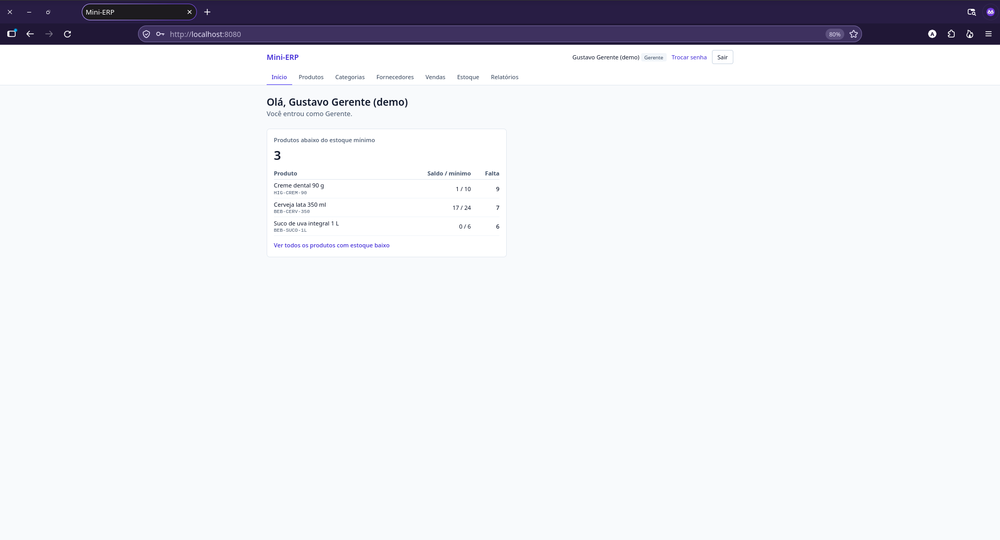
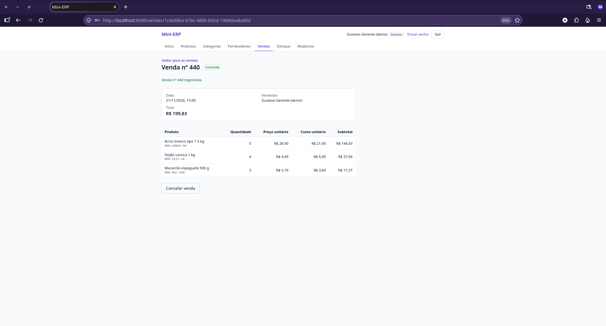
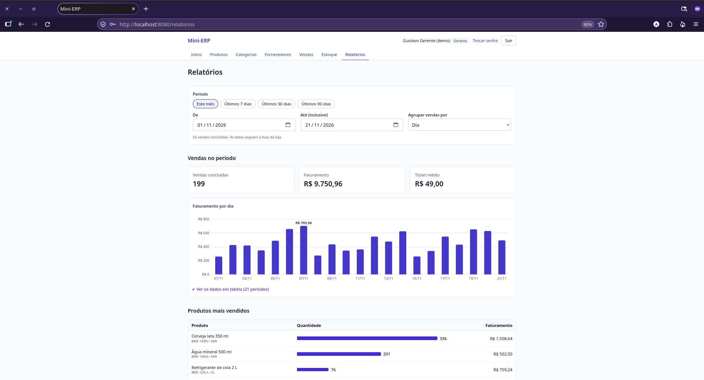
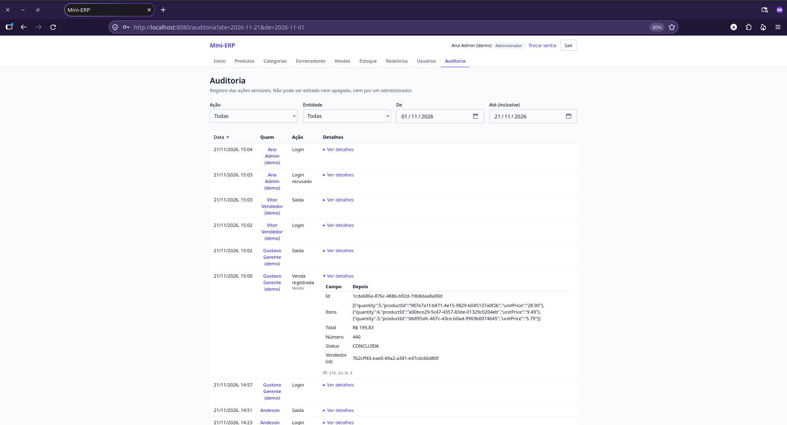
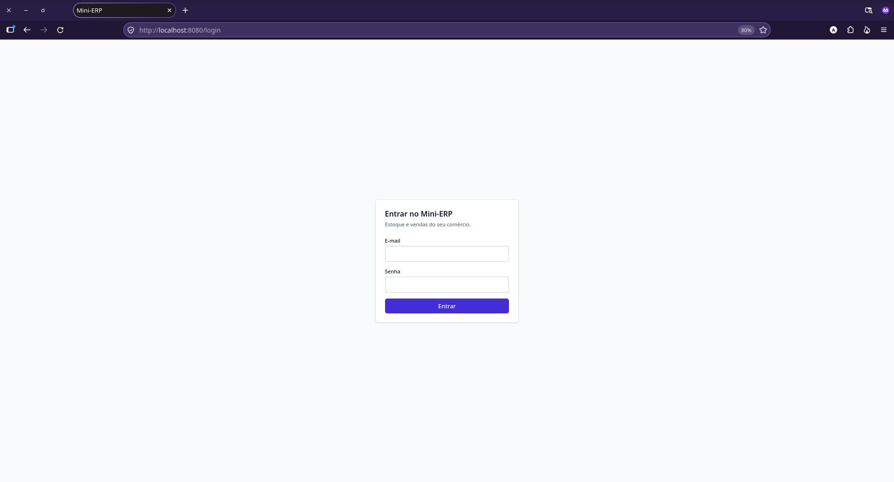

# Mini-ERP de estoque e vendas

Sistema web para pequeno comércio controlar produtos, estoque e vendas, com três papéis de usuário (administrador, gerente e vendedor).

**Demonstração:** https://mini-erp-estoque-vendas.vercel.app
**Documentação da API (Swagger):** https://mini-erp-estoque-vendas.vercel.app/api/docs

Para testar sem cadastro, entre com uma das contas de demonstração (senha `demo-mini-erp` para as três):

| Papel | E-mail | O que dá para ver |
|---|---|---|
| Administrador | `admin.demo@example.com` | tudo, inclusive usuários e auditoria |
| Gerente | `gerente.demo@example.com` | catálogo, estoque, todas as vendas e relatórios |
| Vendedor | `vendedor.demo@example.com` | produtos (sem custo) e as próprias vendas |

O primeiro acesso depois de um tempo parado é lento: no plano gratuito do Render, a API desliga após 15 minutos sem uso e leva alguns segundos para voltar. Os dados da demonstração são recriados todo dia às 6h (horário de Brasília), então fique à vontade para criar, vender e cancelar.



## O problema

Num comércio pequeno, o estoque costuma ficar numa planilha que ninguém confia. O sistema resolve isso registrando cada entrada, venda, cancelamento e ajuste, e a parte técnica central é garantir que esse registro nunca fique inconsistente, mesmo quando tudo acontece ao mesmo tempo:

- **Duas vendas da última unidade no mesmo instante.** A baixa do estoque é um único comando no banco que só desconta se ainda houver saldo. Uma das vendas passa e a outra recebe uma mensagem com o saldo disponível; o estoque nunca fica negativo.
- **O vendedor clica duas vezes em "Registrar venda", ou a rede cai e o navegador repete o pedido.** Cada tentativa leva uma chave de idempotência gerada no navegador. Se o mesmo pedido chegar de novo, a API devolve a venda já criada, sem baixar o estoque outra vez.
- **Duas vendas com os mesmos produtos em ordens diferentes.** Os itens são sempre baixados na mesma ordem, o que elimina o deadlock entre elas.
- **Alguém tenta apagar o rastro.** O histórico de estoque e a auditoria são só de inserção: um trigger no PostgreSQL recusa alteração e exclusão, inclusive para o administrador.
- **Uma venda às 23h30 aparece no dia seguinte do relatório.** Os relatórios fecham os períodos no fuso horário da loja, não em UTC.

## Telas

| | |
|---|---|
|  |  |
| Venda registrada: preço e custo copiados no momento da venda | Relatório de vendas por período, com gráfico e tabela acessível |
|  |  |
| Auditoria: quem fez o quê, quando e o que mudou | Login |

## Funcionalidades

- **Catálogo:** produtos, categorias e fornecedores, com busca, filtros, ordenação e paginação que ficam na URL (o F5 mantém a lista).
- **Estoque:** entrada, saída manual e ajuste de inventário (informando o saldo contado); extrato por produto; alerta de produtos abaixo do mínimo.
- **Vendas:** venda com vários itens, cancelamento com motivo obrigatório e devolução do estoque; o vendedor só vê as próprias vendas e não cancela.
- **Relatórios:** vendas e faturamento por dia, semana ou mês, produtos mais vendidos e valor do estoque a custo e a preço de venda.
- **Usuários e auditoria (administrador):** cadastro, papéis e desativação; registro de logins, vendas, cancelamentos, ajustes, mudanças de preço e acessos negados, com o estado antes e depois.

## Segurança

- Senhas com argon2id; access token de 15 minutos só em memória no navegador e refresh token em cookie `HttpOnly`, `Secure` e `SameSite=Strict`, com rotação e detecção de reuso.
- Trocar a senha ou desativar um usuário invalida na hora os tokens já emitidos.
- Controle de acesso por papel negado por padrão: uma rota sem permissão declarada responde 403.
- Rate limiting por IP, bloqueio de login por conta (5 falhas em 15 minutos), helmet, CORS restrito e CSP sem `unsafe-inline` no front.
- Consultas parametrizadas e ordenação só por uma lista de campos permitidos.
- Na demonstração, as contas demo não podem ter senha, e-mail, papel ou ativação alterados, para o próximo visitante continuar conseguindo entrar.

## Stack

- **Back-end:** NestJS 12, TypeScript 6 (strict), Prisma 7, PostgreSQL, zod e class-validator, pino (logs estruturados), Swagger
- **Front-end:** React 19, Vite 8, React Router, TanStack Query, React Hook Form com zod, Tailwind 4
- **Testes:** Vitest e Supertest com banco real (API); Testing Library, MSW e axe-core (front)
- **Infraestrutura:** Docker Compose com Nginx, GitHub Actions (lint, testes, build e smoke test do Compose), Dependabot
- **Produção:** front na Vercel, API no Render (Docker) e banco no Neon (PostgreSQL)

```
navegador ──> Vercel (front + repasse de /api) ──> Render (API NestJS) ──> Neon (PostgreSQL)
```

O navegador fala com uma origem só: a Vercel repassa `/api` para o Render, como o Nginx faz no Compose local. Assim o cookie `SameSite=Strict` funciona e o CORS nem entra em jogo.

## Como rodar

Pré-requisitos: Docker com Compose, Node 22 (veja `.nvmrc`) e npm.

### Tudo em containers

```bash
docker compose up --build --detach --wait
docker compose exec -T api node dist/seed-demo.js
```

O primeiro comando sobe banco, API e front; as migrations são aplicadas quando a API sobe. O segundo cria as contas e os dados de demonstração (cerca de 8 semanas de vendas). Para recriar os dados depois, use `seed-demo.js --reset`, que **apaga** o banco do Compose antes.

Tudo entra pelo Nginx, na porta 8080:

- Aplicação: http://localhost:8080 (contas da tabela acima, senha `demo-mini-erp`)
- Swagger: http://localhost:8080/api/docs

Smoke test do ambiente, o mesmo do CI (depois do seed de demonstração): `sh docker/smoke-test.sh`.

Para parar: `docker compose down` (com `--volumes`, apaga também os dados).

O cookie de sessão sai com `Secure`. Chrome e Firefox aceitam esse cookie em `http://localhost`; em navegadores que não aceitam, o login funciona, mas a sessão não sobrevive a um F5.

### Desenvolvimento

```bash
docker compose up --detach --wait db   # só o PostgreSQL, na porta 5433
cd backend
cp .env.example .env
npm ci
npm run db:deploy                      # aplica as migrations
npm run seed:demo                      # dados de demonstração (senha em DEMO_PASSWORD)
npm run start:dev                      # API em http://localhost:3000
```

Em outro terminal:

```bash
cd frontend
npm ci
npm run dev                            # http://localhost:5173
```

O Vite repassa `/api` para a API, então front e API ficam na mesma origem, como em produção.

### Testes

Dentro de `backend/`, com o banco do Compose rodando:

```bash
npm run lint
npm run typecheck
npm test            # unitários
npm run test:e2e    # e2e com Supertest, no banco mini_erp_test
```

Dentro de `frontend/` (os testes usam uma API simulada com MSW, sem precisar da API):

```bash
npm run lint        # inclui regras de acessibilidade (jsx-a11y)
npm run typecheck
npm test            # Testing Library + axe-core
```

Em máquinas com pouca memória, limite os workers do front: `npx vitest run --maxWorkers=3`.

Além dos testes automatizados, o sistema foi testado à mão no navegador seguindo um [roteiro de 50 itens](docs/roteiro-teste-manual.md), sem falhas.

## Decisões técnicas e trade-offs

O plano completo, com modelagem, matriz de permissões, riscos e as mais de 100 decisões numeradas, está em [docs/plano.md](docs/plano.md). Os conceitos de cada fase, com perguntas de entrevista, estão em [docs/aprendizados.md](docs/aprendizados.md). Algumas das principais:

- **Saldo desnormalizado, mas sempre igual à soma das movimentações.** O saldo fica no produto para a listagem ser rápida, e um único serviço o altera, sempre junto com a movimentação, na mesma transação. Um teste confere que saldo e soma batem.
- **Preço copiado na venda.** O preço e o custo de cada item vêm do banco (nunca do cliente) e ficam gravados na venda: mudar o preço amanhã não muda o faturamento de ontem.
- **Cancelamento só por gerente e administrador.** Se o vendedor pudesse cancelar a própria venda, poderia vender, receber em dinheiro e apagar o registro do caixa.
- **Dados de demonstração gerados em memória e gravados de uma vez.** Como o histórico não aceita UPDATE, a história de 8 semanas nasce com as datas certas; o seed confere no final que saldos e totais batem, ou desfaz tudo.
- **`trust proxy` medido em produção.** O valor foi escolhido comparando o IP gravado na auditoria com o IP real, pelos dois caminhos de entrada e com um cabeçalho `X-Forwarded-For` forjado. Pela Vercel, a API vê o IP do proxy; por isso existe o bloqueio de login por conta, que não depende do IP.
- **Gráficos em SVG feitos à mão, sem biblioteca,** para não pesar no carregamento; as páginas são carregadas sob demanda, e o pacote principal caiu de 578 kB para 251 kB.

## Limitações e próximos passos

- **API "dorme" no plano gratuito:** o primeiro acesso depois de 15 minutos parado é lento.
- **Deploy da API disparado à mão:** o deploy automático do Render a cada merge ainda não está funcionando; o front na Vercel é atualizado automaticamente.
- **Rate limit por IP mais fraco pela Vercel:** a API vê os IPs de saída da Vercel, que são compartilhados entre visitantes. O bloqueio por conta cobre a força bruta contra uma conta específica.
- **Reset diário depende do GitHub Actions,** que desativa workflows agendados depois de 60 dias sem atividade no repositório.
- **Fora do escopo:** pagamentos, emissão de nota fiscal, várias lojas, devolução parcial de venda (o cancelamento é sempre total) e recuperação de senha por e-mail.
- **Próximos passos:** botões "entrar como" na tela de login para a demonstração, deploy automático da API e migração para o TypeScript 7 quando as dependências permitirem.
