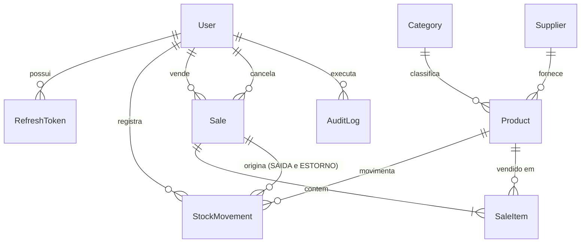

# Plano do Mini-ERP de estoque e vendas

Status: aprovado em 17/11/2026. Repositório: [AndesondaCruz/mini-erp-estoque-vendas](https://github.com/AndesondaCruz/mini-erp-estoque-vendas) (público).

## 1. Objetivo e escopo do MVP

Sistema para pequeno comércio controlar produtos, estoque e vendas, com três papéis de usuário.

Dentro do MVP:

- Autenticação JWT (access + refresh token) e papéis ADMIN, GERENTE e VENDEDOR.
- Cadastro de produtos com categoria, fornecedor, preço de custo, preço de venda e estoque mínimo.
- Movimentações de estoque (entrada, saída, ajuste) com histórico e responsável.
- Vendas com vários itens, baixa automática de estoque e bloqueio de venda sem saldo.
- Cancelamento total de venda, com estorno automático do estoque, motivo obrigatório e responsável.
- Alerta de produtos abaixo do estoque mínimo.
- Relatórios: vendas por período, produtos mais vendidos, valor do estoque.
- Log de auditoria das ações sensíveis.

Fora do MVP (fica em "próximos passos" no README): devolução parcial (cancelar só alguns itens de uma venda), múltiplos depósitos, formas de pagamento, emissão fiscal, importação de planilhas, multi-empresa.

Por que a devolução parcial ficou de fora: ela exige controlar, por item, quanto já foi devolvido e impedir devolver mais do que foi vendido. O cancelamento total resolve o caso principal (venda registrada por engano) com uma regra simples.

## 2. Stack e decisão ORM: Prisma ou TypeORM

| Critério | Prisma | TypeORM |
|---|---|---|
| Tipagem | Client gerado a partir do schema; tipos de retorno seguem o `select`/`include` usado | Tipos das entidades, mas query builder e `find` são mais soltos |
| Migrations | `prisma migrate` gera SQL a partir do schema; fácil de revisar | Geração a partir das entidades funciona, mas exige mais cuidado com divergências |
| Integração NestJS | Via um `PrismaService` simples | Módulo oficial `@nestjs/typeorm`, decorators nas classes |
| Controle de concorrência | Transação interativa (`$transaction`), `updateMany` condicional atômico, SQL cru via `$queryRaw` para `FOR UPDATE` | `pessimistic_write` nativo, query builder para `UPDATE ... WHERE` |
| Constraints avançadas (CHECK) | Não declara no schema; entra em SQL manual na migration | Idem (decorator `@Check` existe, mas é pouco usado) |
| Curva de aprendizado | Menor | Maior, mas é conhecimento muito pedido em vagas NestJS |

Decisão (aprovada): Prisma.

- O ganho de tipagem reduz bugs de modelagem, que é exatamente o risco deste projeto.
- Nenhuma das regras críticas depende de lock explícito do ORM. A proteção da venda é um `UPDATE ... WHERE saldo >= quantidade` atômico mais um `CHECK` no banco (seção 5). Isso funciona igual nos dois ORMs.
- Trade-off aceito: CHECK constraints entram como SQL escrito à mão dentro da migration do Prisma.
- Alternativa descartada: TypeORM. É uma boa escolha e vale conhecer, mas a vantagem dele (lock pessimista pronto) não é necessária aqui. Se o seu `agendamento-exames` já usa TypeORM, usar Prisma neste projeto amplia o portfólio.

Versões verificadas na instalação (Fase 0, 17/11/2026):

- NestJS 12 (projeto ESM: imports relativos terminam em `.js`).
- TypeScript 6.0.x. A 7 foi descartada por enquanto: o `typescript-eslint` e parte do ecossistema ainda exigem `<6.1`.
- Prisma 7.10.1, fixado em versão exata (`prisma`, `@prisma/client` e `@prisma/adapter-pg`). Motivo: o dist-tag `latest` do `prisma` no npm apontava para `8.0.0-rc.34`, um release candidate, enquanto o `@prisma/client` estava em 7.10.1. Um `npm install prisma` comum instalaria versões incompatíveis.
- Testes com Vitest (padrão do CLI do Nest 12), não Jest.

Demais componentes:

- Back-end: NestJS, TypeScript strict, class-validator, Swagger, pino (logs estruturados), helmet, `@nestjs/throttler`, argon2 (variante argon2id) para hash de senha. Decisão aprovada: é a recomendação atual da OWASP e resiste melhor a ataques com GPU porque exige muita memória por tentativa. Trade-off aceito: depende de módulo nativo, o que exige atenção na imagem Docker. Alternativa descartada: bcrypt, mais simples de instalar, mas limitado a 72 bytes de senha e menos resistente a hardware dedicado.
- Front-end: React + TypeScript + Vite, TanStack Query, Tailwind, React Router, React Hook Form + zod.
- Testes: Vitest (unitários nos services), Supertest (e2e), Testing Library + axe-core no front.
- Infra: Docker Compose, GitHub Actions, Dependabot.

Restrição de memória (8 GB, ~2,5 GB livres agora): em desenvolvimento, o Compose sobe só Postgres e API; o front roda com `vite dev` fora do contêiner. O Compose "tudo em um comando" (exigido no padrão de pronto) sobe também o front compilado, servido por Nginx, e será o modo de demonstração.

## 3. Modelagem do banco

### 3.1 Diagrama

### 3.2 Entidades e o porquê de cada uma

Convenções: chave primária UUID (evita expor contagem de registros e facilita IDs em fixtures), `createdAt`/`updatedAt` em `timestamptz` (UTC), dinheiro em `Decimal(12,2)`, nunca `float`. Nomes de tabela e coluna em snake_case no banco via `@map`.

**User**
- Campos: `id`, `name`, `email` (único), `passwordHash`, `role` (enum ADMIN | GERENTE | VENDEDOR), `active`, timestamps.
- Por quê: um papel por usuário basta para três papéis fixos. Uma tabela de permissões dinâmicas seria excesso para o MVP. `active` permite desligar um usuário sem apagar o histórico (vendas e auditoria apontam para ele).

**RefreshToken**
- Campos: `id`, `userId`, `tokenHash`, `expiresAt`, `revokedAt`, `replacedById` (opcional).
- Por quê: guardar só o hash do refresh token permite revogar e rotacionar. O token em texto puro nunca fica no banco, como senha. `replacedById` encadeia a rotação para detectar reuso (seção 5, risco 9).

**Category**
- Campos: `id`, `name` (único), timestamps.
- Por quê: tabela própria evita categorias digitadas de formas diferentes ("Bebida", "bebidas") e permite relatório por categoria depois.

**Supplier**
- Campos: `id`, `name`, `document` (CNPJ, opcional e único quando presente), `phone`, `email`, `active`, timestamps.
- Por quê: fornecedor é uma entidade real do negócio, com contato. Fica como cadastro simples; sem pedidos de compra no MVP.

**Product**
- Campos: `id`, `sku` (único), `name`, `categoryId`, `supplierId`, `costPrice`, `salePrice`, `minStock`, `currentStock`, `active`, timestamps.
- Por quê:
  - `currentStock` é um saldo desnormalizado. Somar todo o histórico a cada venda seria lento e difícil de travar. O custo é ter de manter saldo e histórico coerentes, tratado no risco 3.
  - `active` em vez de DELETE: produto com histórico nunca é apagado (FKs com `ON DELETE RESTRICT`).
  - Constraints no banco: `CHECK (current_stock >= 0)`, `CHECK (sale_price >= 0)`, `CHECK (cost_price >= 0)`, `CHECK (min_stock >= 0)`.
  - Índices: `sku` (único), `categoryId`, `supplierId`, `name` (busca).

**StockMovement** (imutável: só INSERT, nunca UPDATE/DELETE)
- Campos: `id`, `productId`, `type` (ENTRADA | SAIDA | AJUSTE | ESTORNO), `quantity` (inteiro com sinal: positivo soma, negativo subtrai), `balanceAfter`, `reason` (texto; obrigatório em AJUSTE e ESTORNO), `saleId` (opcional; preenchido em SAIDA de venda e em ESTORNO), `userId`, `createdAt`.
- ESTORNO é um tipo próprio, e não uma ENTRADA, para o histórico e os relatórios separarem "mercadoria comprada do fornecedor" de "venda desfeita". Alternativa descartada: reaproveitar ENTRADA com um motivo em texto, que obrigaria a filtrar por texto livre.
- Por quê:
  - Quantidade com sinal torna o saldo sempre `soma(quantity)`, o que permite auditar a coerência com uma única query.
  - `balanceAfter` guarda o saldo resultante naquela linha, o que dá um extrato legível e um ponto de verificação.
  - `saleId` liga a saída automática à venda que a gerou.
  - `userId` é o "responsável" exigido no escopo.
  - Índice em `(productId, createdAt)` para o histórico do produto.

**Sale**
- Campos: `id`, `number` (sequencial legível), `sellerId`, `total`, `status` (enum CONCLUIDA | CANCELADA), `idempotencyKey` (único), `createdAt`, `canceledAt`, `canceledById`, `cancelReason`.
- Por quê: `total` é gravado, não recalculado, para o relatório continuar correto mesmo que algo mude depois. `idempotencyKey` evita venda duplicada por duplo clique ou retry (risco 5). Índice em `createdAt` e em `(sellerId, createdAt)` para relatórios e "minhas vendas".
- Cancelamento muda o `status` em vez de apagar a venda: a venda cancelada continua no histórico, com quem cancelou, quando e por quê. Constraint no banco: `CHECK` que exige `canceledAt`, `canceledById` e `cancelReason` preenchidos quando, e somente quando, `status = 'CANCELADA'`. Índice em `(status, createdAt)` para os relatórios, que consideram só vendas concluídas.

**SaleItem**
- Campos: `id`, `saleId`, `productId`, `quantity`, `unitPrice`, `unitCost`, `subtotal`.
- Por quê: `unitPrice` e `unitCost` são cópias (snapshot) do valor no momento da venda. Se o preço do produto mudar amanhã, a venda de hoje não pode mudar. O `unitCost` permite relatório de lucro no futuro. Restrição única `(saleId, productId)`: o mesmo produto não aparece em duas linhas da mesma venda. `CHECK (quantity > 0)`.

**AuditLog** (append-only)
- Campos: `id`, `userId` (opcional, para ações sem usuário como login falho), `action`, `entity`, `entityId`, `before` (JSON), `after` (JSON), `ip`, `createdAt`.
- Por quê: responde "quem fez o quê e quando". `before`/`after` mostram a mudança exata. Nunca grava senha, hash ou token (filtro explícito por lista de campos permitidos).
- Ações auditadas: login (sucesso e falha), criação/edição/desativação de usuário e mudança de papel, alteração de preço de custo ou venda, ajuste e saída manual de estoque, desativação de produto, cada venda registrada, cada venda cancelada, acesso negado (403) em rotas sensíveis.

### 3.3 Papéis: por que enum e não tabela

Três papéis fixos, conhecidos em tempo de compilação, usados em decorators `@Roles(...)`. Tabela de papéis/permissões só compensa quando o cliente define papéis. Fica em "próximos passos".

## 4. Matriz de permissões

Legenda: C = criar, R = ler, U = editar, D = desativar, "próprio" = só os registros do usuário logado.

| Recurso / ação | ADMIN | GERENTE | VENDEDOR |
|---|---|---|---|
| Usuários (CRUD, trocar papel) | C R U D | nada | nada |
| Próprio perfil e troca de senha | R U | R U | R U |
| Categorias | C R U D | C R U D | R |
| Fornecedores | C R U D | C R U D | nada |
| Produtos: leitura | R (com custo) | R (com custo) | R (sem `costPrice`) |
| Produtos: criar/editar | C U | C U | nada |
| Produtos: alterar preços | sim (auditado) | sim (auditado) | nada |
| Produtos: desativar | D | nada | nada |
| Movimentação: ENTRADA | sim | sim | nada |
| Movimentação: SAIDA manual | sim | sim | nada |
| Movimentação: AJUSTE | sim | sim (exige motivo) | nada |
| Movimentação: histórico | R | R | nada |
| Vendas: registrar | sim | sim | sim |
| Vendas: listar/ver | todas | todas | só as próprias |
| Vendas: cancelar (com motivo) | sim (auditado) | sim (auditado) | nada |
| Alertas de estoque mínimo | R | R | R (contagem e nomes, sem custo) |
| Relatório de vendas por período | R (todos os vendedores) | R (todos os vendedores) | nada |
| Relatório de mais vendidos | R | R | nada |
| Relatório de valor do estoque | R | R | nada |
| Auditoria | R | nada | nada |

Pontos de atenção da matriz:

- O VENDEDOR não pode ver preço de custo (margem do negócio). Isso é aplicado no DTO de resposta (campo omitido), não só escondido no front.
- O VENDEDOR não cancela vendas, nem as próprias. Permitir abriria uma fraude clássica: vender, receber em dinheiro e cancelar a venda para apagar o registro do caixa. Cancelar exige alguém de papel superior, com motivo e auditoria.
- "Próprio" no VENDEDOR é aplicado no service (filtro por `sellerId`), nunca confiando em parâmetro vindo do cliente.
- Autorização é por `RolesGuard` global com `@Roles()` por rota, com política padrão de negar quando a rota não declara papéis.

## 5. Pontos em que a modelagem pode dar errado (e o tratamento)

### Risco 1: duas vendas simultâneas do último item

Cenário: saldo = 1. Vendedor A e vendedor B confirmam ao mesmo tempo. Se o código faz "lê saldo, confere, grava saldo-1", as duas leituras veem 1, as duas passam na conferência e o saldo termina em -1 (ou 0 com duas vendas, perdendo uma atualização).

Tratamento em três camadas:

1. Baixa atômica e condicional no banco, dentro da transação da venda:
   `UPDATE products SET current_stock = current_stock - :qtd WHERE id = :id AND current_stock >= :qtd`
   Se afetou 0 linhas, o saldo era insuficiente: a transação inteira é revertida e a API responde 409 com o produto e o saldo disponível. O Postgres serializa as duas atualizações na mesma linha: a segunda espera a primeira confirmar, relê o saldo já atualizado (0) e falha na condição.
2. `CHECK (current_stock >= 0)` no banco como última barreira, caso algum código futuro esqueça a condição.
3. Teste e2e que dispara N vendas concorrentes (`Promise.all`) do último item e afirma: exatamente uma venda tem sucesso, as demais recebem 409, saldo final = 0.

Alternativa descartada: `SELECT ... FOR UPDATE` e depois UPDATE. Funciona, mas são dois passos e o lock fica preso por mais tempo. Também descartado: nível de isolamento SERIALIZABLE, que exigiria retry de transações abortadas. O `UPDATE` condicional resolve com isolamento padrão (READ COMMITTED).

### Risco 2: deadlock em vendas com vários itens

Cenário: venda A baixa produtos [1, 2]; venda B baixa [2, 1]. A trava o 1 e quer o 2; B trava o 2 e quer o 1. Deadlock.

Tratamento: dentro da transação, ordenar os itens por `productId` antes de baixar o estoque. Toda venda trava as linhas na mesma ordem, o que elimina o ciclo. Itens repetidos do mesmo produto na requisição são somados ou rejeitados na validação (decisão: rejeitar com 400, mais simples e explícito). Teste e2e com duas vendas cruzadas concorrentes.

### Risco 3: saldo e histórico divergirem

Cenário: `currentStock` diz 10, mas a soma das movimentações dá 8 (algum caminho de código alterou um sem o outro).

Tratamento:
- Existe um único serviço (`StockService`) autorizado a alterar `currentStock`, e ele sempre grava a `StockMovement` na mesma transação. Nenhum outro módulo atualiza esse campo.
- `balanceAfter` em cada movimentação dá um ponto de conferência.
- Teste de invariante: após cenários de vendas, entradas e ajustes, `currentStock == soma(quantity)` para todo produto.
- Query de reconciliação documentada para uso operacional.

### Risco 4: ajuste de estoque concorrente com venda

Cenário: o gerente faz inventário e informa "contei 7" enquanto uma venda baixa 2 ao mesmo tempo. Gravar "saldo = 7" apagaria a venda.

Tratamento: o ajuste é registrado como diferença calculada dentro da transação, sob lock da linha do produto (`SELECT ... FOR UPDATE`): `delta = contado - saldoAtualTravado`. A venda concorrente espera o ajuste terminar. Esse é o único ponto com lock explícito, justificado porque o ajuste lê o saldo e precisa que ele não mude até gravar. Motivo é obrigatório e a ação vai para auditoria.

### Risco 5: venda duplicada (duplo clique, retry de rede)

Cenário: o front envia o POST duas vezes; sem proteção, o cliente é cobrado e o estoque baixa em dobro.

Tratamento: o front gera um `Idempotency-Key` (UUID) por tentativa de venda e envia em header. A coluna `Sale.idempotencyKey` é única. Segunda requisição com a mesma chave devolve a venda já criada (200) em vez de criar outra. Além disso, o botão fica desabilitado enquanto a mutation está pendente.

### Risco 6: preço adulterado ou desatualizado

Cenário: o cliente HTTP envia `unitPrice: 0.01`; ou o preço muda entre abrir a tela e confirmar.

Tratamento: a API nunca aceita preço do cliente. O servidor lê o preço atual do produto dentro da transação, calcula `subtotal` e `total` e grava o snapshot em `SaleItem`. O total mostrado no front é só informativo. Valores em `Decimal`; cálculo no servidor com a mesma precisão do banco (sem `number` de ponto flutuante do JS para somar dinheiro; usar a classe Decimal do Prisma).

### Risco 7: produto desativado ou apagado com histórico

Tratamento: sem DELETE físico de produto, categoria e fornecedor com vínculos (`ON DELETE RESTRICT`). Produto inativo não pode ser vendido nem receber nova movimentação de saída; o histórico continua legível. Validado dentro da transação da venda (um produto pode ser desativado entre a abertura da tela e a confirmação).

### Risco 8: vazamento de dados entre papéis (IDOR e campos sensíveis)

Cenário: o VENDEDOR chama `GET /sales/{id}` de outro vendedor, ou lê `costPrice` pela API mesmo com o front escondendo.

Tratamento: filtros por papel aplicados no service; DTOs de resposta distintos por papel (ou serialização que omite `costPrice`); teste e2e por papel para cada rota sensível (espera 403/404 e ausência do campo).

### Risco 9: roubo ou reuso de refresh token

Tratamento: access token curto, refresh token com rotação: cada uso emite um novo token e revoga o anterior. Se um token já revogado for apresentado, a cadeia inteira daquele usuário é revogada e o evento vai para auditoria. Refresh token guardado só como hash. Senha com argon2 ou bcrypt. Rate limiting mais rígido em `/auth/login`.

### Risco 10: auditoria incompleta ou adulterável

Cenário: ação concluída mas log não gravado (falha no meio), ou log apagado.

Tratamento: o registro de auditoria das ações sensíveis é feito na mesma transação da ação (ou ambas acontecem, ou nenhuma). A API não expõe rota de edição ou exclusão de auditoria. Os campos `before`/`after` passam por filtro que remove segredos. Logs de aplicação (pino) são separados e não substituem a auditoria.

### Risco 11: relatórios com período errado por fuso horário

Cenário: venda às 22h em Natal (UTC-3) cai no dia seguinte em UTC; "vendas de hoje" sai errado.

Tratamento: tudo armazenado em UTC (`timestamptz`); o limite do período é convertido usando o fuso `America/Fortaleza` na query (`AT TIME ZONE`). O fuso é configurável por variável de ambiente. Agregações feitas em SQL, não em memória; índice em `Sale.createdAt`. Teste com vendas perto da meia-noite.

### Risco 12: listagens e ordenação inseguras ou lentas

Tratamento: paginação obrigatória com limite máximo; ordenação só por lista de campos permitidos por rota (nunca string livre do cliente); consultas sempre parametrizadas (Prisma já faz; no SQL cru usar `$queryRaw` com template tagged, nunca concatenação).

### Risco 13: alerta de estoque mínimo desatualizado

Tratamento: o alerta é calculado na consulta (`currentStock <= minStock` entre produtos ativos), não armazenado em tabela. Assim nunca fica desatualizado. Trade-off: se virar gargalo com milhares de produtos, um índice parcial ou coluna calculada resolve; hoje seria otimização prematura.

### Risco 14: cancelamento de venda

Cenários e tratamento:

- Dois gerentes cancelam a mesma venda ao mesmo tempo, ou o mesmo gerente clica duas vezes: sem proteção, o estoque seria estornado em dobro. Tratamento: troca de status atômica e condicional, `UPDATE sales SET status = 'CANCELADA', ... WHERE id = :id AND status = 'CONCLUIDA'`. Se afetou 0 linhas, a venda já estava cancelada: a transação é revertida e a API responde 409. É o mesmo padrão da baixa de estoque (risco 1), aplicado ao status.
- Estorno parcial por falha no meio: a troca de status, o estorno de todos os itens (`StockService`, tipo ESTORNO, com `saleId`) e a auditoria acontecem na mesma transação. Os itens são estornados em ordem de `productId`, pelo mesmo motivo do risco 2 (evitar deadlock com vendas concorrentes).
- Produto desativado depois da venda: o estoque volta mesmo assim, porque a mercadoria voltou fisicamente para a loja. O estorno não passa pela validação de "produto ativo", que vale só para venda e saída.
- Relatórios inflados: vendas por período, mais vendidos e totais consideram só `status = 'CONCLUIDA'`. Teste: vender, cancelar e conferir que o relatório não muda.
- Cancelamento muito antigo: no MVP não há prazo limite. Fica documentado como próximo passo (por exemplo, só cancelar no mesmo dia ou exigir ADMIN depois de X dias).

## 6. Rotas da API

Prefixo `/api/v1`. Documentação gerada em `/api/docs` (Swagger). Todas as rotas exigem JWT, exceto as marcadas como públicas. Papéis entre parênteses: A = ADMIN, G = GERENTE, V = VENDEDOR.

**Saúde e documentação**
- `GET /health` (público): estado da API e conexão com o banco.

**Auth**
- `POST /auth/login` (público, rate limit rígido): devolve access e refresh token.
- `POST /auth/refresh` (público com refresh token válido): rotaciona tokens.
- `POST /auth/logout`: revoga o refresh token atual.
- `GET /auth/me`: perfil do usuário logado.
- `PATCH /auth/me/password`: troca a própria senha.

**Usuários (A)**
- `GET /users`, `POST /users`, `GET /users/:id`
- `PATCH /users/:id` (dados, papel, ativo)

**Categorias**
- `GET /categories` (A, G, V)
- `POST /categories`, `PATCH /categories/:id`, `DELETE /categories/:id` (A, G; delete só se sem produtos)

**Fornecedores (A, G)**
- `GET /suppliers`, `POST /suppliers`, `GET /suppliers/:id`, `PATCH /suppliers/:id`, `DELETE /suppliers/:id` (desativa)

**Produtos**
- `GET /products` (A, G, V): filtros `search`, `categoryId`, `supplierId`, `lowStock`, paginação, ordenação permitida.
- `GET /products/:id` (A, G, V)
- `POST /products` (A, G)
- `PATCH /products/:id` (A, G)
- `DELETE /products/:id` (A): desativa.

**Estoque**
- `POST /stock/movements` (A, G): corpo com `productId`, `type`, `quantity`, `reason`.
- `GET /stock/movements` (A, G): filtros por produto, tipo, período, responsável.
- `GET /products/:id/movements` (A, G): extrato do produto.
- `GET /stock/alerts` (A, G, V): produtos com saldo menor ou igual ao mínimo.

**Vendas**
- `POST /sales` (A, G, V): header `Idempotency-Key`; corpo com a lista de `{ productId, quantity }`.
- `GET /sales` (A, G: todas; V: próprias): paginação e filtros de período e status.
- `GET /sales/:id` (A, G; V só se for dono).
- `POST /sales/:id/cancel` (A, G): corpo com `reason` obrigatório; estorna o estoque; 409 se já cancelada.

**Relatórios (A, G)**: consideram apenas vendas com status CONCLUIDA.
- `GET /reports/sales?from=&to=&groupBy=day|week|month`
- `GET /reports/top-products?from=&to=&limit=`
- `GET /reports/stock-value`: valor total ao custo e ao preço de venda, por categoria.

**Auditoria (A)**
- `GET /audit-logs`: filtros por usuário, ação, entidade, período.

Padrão de erro (filtro global): `{ statusCode, error, message, details?, path, timestamp, requestId }`. Códigos usados: 400 validação, 401 não autenticado, 403 sem permissão, 404, 409 conflito (estoque insuficiente, SKU duplicado), 429 rate limit.

## 7. Fases de entrega

Regra de trabalho: uma branch e um PR por feature, título em Conventional Commits, descrição em português (o que muda, por quê, como testar), merge só com CI verde, sem push direto na main. Ao fim de cada feature entra uma seção em `docs/aprendizados.md` (conceitos, decisões, alternativas descartadas, três perguntas de entrevista). Build, lint e testes rodam antes e depois de cada mudança.

**Fase 0: fundação** (`chore/project-setup`)
- `git init` na raiz, `.gitignore`, `.env.example`, estrutura `backend/` e `frontend/`.
- Compose com Postgres; NestJS com TypeScript strict, validação global, filtro global de erros, pino, helmet, CORS restrito, throttler, Swagger, `GET /health`.
- Prisma configurado. A primeira migration nasce na Fase 1: o Prisma não gera migration sem nenhum model.
- CI no GitHub Actions (lint, testes, build) e Dependabot.
- Repositório criado pelo GitHub com um README inicial, para a main existir sem push direto nela.

**Fase 1: autenticação, usuários e RBAC**, dividida em dois PRs:

*Parte A* (`feat/auth`)
- Tabelas `User`, `RefreshToken` e `AuditLog` (primeira migration, com CHECKs e trigger de auditoria somente inserção).
- Login, refresh com rotação e detecção de reuso, logout, `me`, troca de senha.
- `JwtAuthGuard` global com `@Public()`; papel, status e `tokenVersion` lidos do banco a cada requisição.
- `AuditService` (gravação na mesma transação da ação, lista de campos permitidos).
- Seed idempotente do primeiro ADMIN; migrations aplicadas pelo entrypoint do container.

*Parte B* (`feat/users-rbac`)
- `@Roles()` e `RolesGuard` com negar por padrão. Ponto para você implementar (modo mentor): eu escrevo os testes antes, você implementa, eu faço o code review.
- CRUD de usuários (ADMIN) com a regra do último ADMIN sob lock (`FOR UPDATE`).
- Desativação e troca de papel revogam sessões e incrementam `tokenVersion`.

**Fase 2: catálogo**, dividida em dois PRs (decisão 11):
- *Parte A* (`feat/catalog-categories-suppliers`): categorias e fornecedores.
- *Parte B* (`feat/catalog-products`): produtos, com CHECKs, soft delete, ocultação de `costPrice` para VENDEDOR, auditoria de alteração de preços.
- Primeiro teste unitário de service: proposto para você escrever.

**Fase 3: movimentações de estoque** (`feat/stock-movements`)
- `StockService` como único ponto de alteração do saldo, ENTRADA, SAIDA, AJUSTE com lock, histórico, extrato, teste de invariante saldo = soma das movimentações.

**Fase 4: vendas** (`feat/sales`)
- Venda com vários itens em uma transação, baixa atômica condicional, ordenação por `productId`, idempotência, snapshot de preço e custo, 409 em estoque insuficiente.
- Testes e2e de concorrência (último item, vendas cruzadas, retry com a mesma chave).
- Ponto para você implementar (modo mentor): a regra de baixa atômica, a primeira regra de negócio crítica.

**Fase 5: cancelamento de venda** (`feat/sale-cancellation`)
- Status da venda, troca atômica de status, estorno de todos os itens com o tipo ESTORNO, auditoria.
- Testes e2e: cancelamento concorrente (só um vence), estorno de produto desativado, VENDEDOR recebe 403.

**Fase 6: alertas e relatórios** (`feat/alerts-reports`)
- Alertas de estoque mínimo, três relatórios com agregações em SQL e fuso configurável, considerando só vendas concluídas.

**Fase 7: front-end base** (`feat/frontend-base`)
- Vite + React + TS, Tailwind, TanStack Query, roteamento, tela de login, guarda de rotas por papel, refresh transparente do token, tratamento de erros da API.

**Fase 8: front-end de catálogo e estoque** (`feat/frontend-catalog-stock`)
- Telas de produtos, categorias, fornecedores, movimentações e alertas; testes com Testing Library e axe-core.

**Fase 9: front-end de vendas e relatórios** (`feat/frontend-sales-reports`)
- Tela de venda (busca de produto, carrinho, `Idempotency-Key`, tratamento de 409), listagem de vendas, cancelamento com confirmação e motivo (ADMIN e GERENTE), relatórios com gráficos simples, tela de auditoria (ADMIN).

**Fase 10: entrega** (`chore/delivery`)
- Compose completo (db, api, front via Nginx) com um único comando, seed de demonstração com usuário demo de cada papel, deploy (Vercel + Render + Neon, planos gratuitos), README completo, teste dos comandos do README em um clone limpo em `/tmp`, `docs/post-linkedin.md`.
- Deploy em produção e publicação são ações que vão pedir sua confirmação.

Observação sobre ordem: o back-end de cada fase é concluído e testado antes do front correspondente, para o contrato da API estabilizar. Se preferir fatias verticais (back e front de cada feature juntos), a ordem muda, mas o número de PRs é o mesmo.

## 8. Critérios de "pronto"

Segue o padrão do `CLAUDE.md` global: TypeScript strict; validação e tratamento global de erros; logs estruturados; migrations (sem `synchronize`); Swagger; hash de senha; JWT com refresh; RBAC; rate limiting, helmet e CORS restrito; consultas parametrizadas e ordenação com lista permitida; testes unitários, e2e e de acessibilidade; Compose com um comando; CI e Dependabot; deploy gratuito com links no topo do README; seed com usuário demo; README com decisões, trade-offs e próximos passos.

## 9. Decisões aprovadas (17/11/2026)

1. ORM: Prisma.
2. Cancelamento total de venda dentro do MVP (Fase 5); devolução parcial fora.
3. Hash de senha: argon2 (argon2id).
4. Fuso padrão dos relatórios: `America/Fortaleza`, configurável por variável de ambiente.
5. Ordem das fases: back-end de cada feature primeiro, depois o front, como na seção 7.
6. Repositório no GitHub: público, `mini-erp-estoque-vendas`, com a main protegida (PR e CI obrigatórios, inclusive para administradores) e exclusão automática da branch após o merge.

Decisões da Fase 1 (17/11/2026):

7. Refresh token em cookie `httpOnly`, `SameSite=Strict`, `Path=/api/v1/auth`. Em produção, a Vercel faz proxy de `/api` para o Render, para o front e a API ficarem no mesmo site e o cookie `Strict` funcionar. Alternativa descartada: token no corpo e no `localStorage`, que qualquer XSS conseguiria ler.
8. Fase 1 dividida em dois PRs (autenticação; usuários e RBAC).
9. JWT com `@nestjs/jwt` e guard próprio. Descartados: Passport (camada extra sem ganho aqui) e `@nestjs/authentication` (versão 0.1.x, recém-publicado e muito mais amplo que o necessário).
10. argon2id com os parâmetros mínimos da OWASP (19 MiB, t=2, p=1), e não o padrão da biblioteca (64 MiB), por causa do limite de memória do container. Hashes antigos são atualizados no login.

Decisões da Fase 2 (17/11/2026):

11. Fase 2 dividida em dois PRs: categorias e fornecedores; depois produtos, que concentram as regras de preço, custo e estoque.
12. Dinheiro trafega no JSON como string decimal (`"12.50"`), validada por regex e convertida direto para o `Decimal` do Prisma, sem passar por `number`. Descartados: número decimal (`0.1 + 0.2` no JavaScript) e centavos inteiros (seguro, mas exige conversão em todo o front).
13. Nome de categoria em `citext`: o `UNIQUE` recusa "bebidas" quando já existe "Bebidas", e o nome continua gravado como foi digitado. Descartado: índice único em `lower(name)`, que o Prisma não conhece e poderia tentar remover numa migration futura.
14. CNPJ no formato alfanumérico da Receita Federal (12 posições de 0-9 ou A-Z e 2 dígitos verificadores; cada caractere vale o código ASCII menos 48 no módulo 11). Uma validação "só 14 dígitos" recusaria CNPJs novos válidos.

Decisões da Fase 3 (17/11/2026):

15. Saída manual exige motivo (além de AJUSTE e ESTORNO, como já previsto). Uma saída que não é venda (avaria, vencimento, consumo interno) é o que alguém vai querer investigar depois. Garantido por CHECK no banco; na Fase 4, a saída gerada por venda passa a ser identificada pela venda.
16. `POST /stock/movements` recebe `quantity` para ENTRADA e SAIDA e `countedStock` para AJUSTE. O gerente informa o que contou, e o servidor calcula a diferença com a linha travada (risco 4). Mandar o campo do outro tipo responde 400.
17. A coluna `saleId` de `StockMovement` entra na Fase 4, junto com a tabela de vendas, para já nascer com chave estrangeira.
18. Exercícios do modo mentor ficam para o fim do projeto, numa rodada única (pedido do Andeson).

Decisões da Fase 4 (18/11/2026):

19. A venda é gravada antes das baixas de estoque. Duas requisições com a mesma `Idempotency-Key` disputam o índice único logo no início, e a segunda falha antes de travar qualquer produto.
20. Preço e custo do item vêm do `RETURNING` do mesmo `UPDATE` que baixa o estoque (`StockService.decreaseReturningPrices`). A linha fica travada até o fim da transação, então o preço não muda entre a leitura e a gravação.
21. `Idempotency-Key` é obrigatória. A mesma chave com itens diferentes ou de outro vendedor responde 409 (erro do cliente, não retry).
22. VENDEDOR que pede a venda de outra pessoa recebe 404, e não 403, para não confirmar que o id existe.
23. A saída gerada por venda dispensa motivo (o CHECK aceita `sale_id` no lugar do motivo); a saída manual continua exigindo. Só SAIDA e ESTORNO podem apontar para uma venda.

Decisões da Fase 5 (18/11/2026):

24. Cancelar responde 200 com a venda atualizada (e não 204), para o front mostrar quem cancelou e quando sem uma segunda requisição.
25. O estorno usa o motivo do cancelamento como `reason` de cada movimentação ESTORNO, além do `saleId`: o extrato do produto explica por que o estoque voltou.

Decisões da Fase 6 (18/11/2026):

26. `from` e `to` dos relatórios são datas de calendário (AAAA-MM-DD), as duas inclusivas, no fuso da loja. O SQL converte para o intervalo UTC `[from 00:00, to + 1 dia 00:00)`. Período máximo de 366 dias.
27. O relatório de vendas devolve todos os períodos do intervalo, inclusive os sem venda (zerados, via `generate_series`).
28. O valor do estoque conta todos os produtos com saldo, inclusive os desativados (a mercadoria continua na loja), e informa quantos estão desativados.
29. O alerta de estoque mínimo usa a mesma regra do filtro `lowStock` de produtos (`current_stock <= min_stock`), só para produtos ativos, ordenado pela maior falta. Trade-off: um produto com mínimo 0 e saldo 0 aparece no alerta; definir mínimo maior que zero é a forma de dizer "quero ser avisado".
30. Semana começa na segunda-feira (padrão ISO do `date_trunc` do Postgres).

Decisões da Fase 7 (18/11/2026):

31. Front-end em TypeScript 6, a mesma versão do back-end. O TypeScript 7 já existe, mas manter uma versão só no repositório é mais simples de manter e explicar.
32. Access token só em memória. Ao abrir ou recarregar a página, o app chama `POST /auth/refresh`: a sessão volta pelo cookie `httpOnly`, sem token exposto ao JavaScript.
33. Renovação "single-flight": várias chamadas com 401 ao mesmo tempo compartilham uma única renovação. Renovações paralelas com o mesmo cookie seriam tratadas pelo back-end como reuso de token.
34. Em desenvolvimento, o Vite faz proxy de `/api` para a API, deixando front e API na mesma origem (o cookie `SameSite=Strict` funciona). Em produção, o mesmo papel é da Vercel (decisão 7).
35. Acessibilidade verificada com `axe-core` direto (helper próprio), e não com o pacote `vitest-axe`, parado na versão 0.1.0. A regra de contraste fica desligada nos testes porque o jsdom não calcula cores.
36. As seções do menu existem desde já, com rotas protegidas por papel e uma tela "em construção". As telas reais chegam nas Fases 8 e 9.
