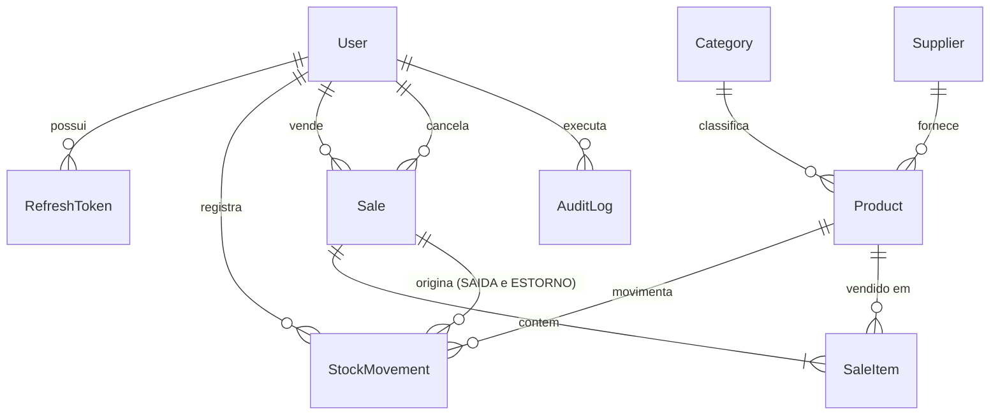

# Plano do Mini-ERP de estoque e vendas

Status: aprovado em 17/11/2026. Repositório: [AndesondaCruz/mini-erp-estoque-vendas](https://github.com/AndesondaCruz/mini-erp-estoque-vendas) (público).

## 1. Objetivo e escopo do MVP

Sistema para pequeno comércio controlar produtos, estoque e vendas, com três papéis de usuário.

Dentro do MVP:

- Autenticação JWT (access + refresh token) e papéis ADMIN, GERENTE e VENDEDOR.
- Cadastro de produtos com categoria, fornecedor, preço de custo, preço de venda e estoque mínimo.
- Movimentações de estoque (entrada, saída, ajuste) com histórico e responsável.
- Vendas com vários itens, baixa automática de estoque e bloqueio de venda sem saldo.
- Cancelamento total de venda, com estorno automático do estoque, motivo obrigatório e responsável.
- Alerta de produtos abaixo do estoque mínimo.
- Relatórios: vendas por período, produtos mais vendidos, valor do estoque.
- Log de auditoria das ações sensíveis.

Fora do MVP (fica em "próximos passos" no README): devolução parcial (cancelar só alguns itens de uma venda), múltiplos depósitos, formas de pagamento, emissão fiscal, importação de planilhas, multi-empresa.

Por que a devolução parcial ficou de fora: ela exige controlar, por item, quanto já foi devolvido e impedir devolver mais do que foi vendido. O cancelamento total resolve o caso principal (venda registrada por engano) com uma regra simples.

## 2. Stack e decisão ORM: Prisma ou TypeORM

| Critério | Prisma | TypeORM |
|---|---|---|
| Tipagem | Client gerado a partir do schema; tipos de retorno seguem o `select`/`include` usado | Tipos das entidades, mas query builder e `find` são mais soltos |
| Migrations | `prisma migrate` gera SQL a partir do schema; fácil de revisar | Geração a partir das entidades funciona, mas exige mais cuidado com divergências |
| Integração NestJS | Via um `PrismaService` simples | Módulo oficial `@nestjs/typeorm`, decorators nas classes |
| Controle de concorrência | Transação interativa (`$transaction`), `updateMany` condicional atômico, SQL cru via `$queryRaw` para `FOR UPDATE` | `pessimistic_write` nativo, query builder para `UPDATE ... WHERE` |
| Constraints avançadas (CHECK) | Não declara no schema; entra em SQL manual na migration | Idem (decorator `@Check` existe, mas é pouco usado) |
| Curva de aprendizado | Menor | Maior, mas é conhecimento muito pedido em vagas NestJS |

Decisão (aprovada): Prisma.

- O ganho de tipagem reduz bugs de modelagem, que é exatamente o risco deste projeto.
- Nenhuma das regras críticas depende de lock explícito do ORM. A proteção da venda é um `UPDATE ... WHERE saldo >= quantidade` atômico mais um `CHECK` no banco (seção 5). Isso funciona igual nos dois ORMs.
- Trade-off aceito: CHECK constraints entram como SQL escrito à mão dentro da migration do Prisma.
- Alternativa descartada: TypeORM. É uma boa escolha e vale conhecer, mas a vantagem dele (lock pessimista pronto) não é necessária aqui. Se o seu `agendamento-exames` já usa TypeORM, usar Prisma neste projeto amplia o portfólio.

Versões verificadas na instalação (Fase 0, 17/11/2026):

- NestJS 12 (projeto ESM: imports relativos terminam em `.js`).
- TypeScript 6.0.x. A 7 foi descartada por enquanto: o `typescript-eslint` e parte do ecossistema ainda exigem `<6.1`.
- Prisma 7.10.1, fixado em versão exata (`prisma`, `@prisma/client` e `@prisma/adapter-pg`). Motivo: o dist-tag `latest` do `prisma` no npm apontava para `8.0.0-rc.34`, um release candidate, enquanto o `@prisma/client` estava em 7.10.1. Um `npm install prisma` comum instalaria versões incompatíveis.
- Testes com Vitest (padrão do CLI do Nest 12), não Jest.

Demais componentes:

- Back-end: NestJS, TypeScript strict, class-validator, Swagger, pino (logs estruturados), helmet, `@nestjs/throttler`, argon2 (variante argon2id) para hash de senha. Decisão aprovada: é a recomendação atual da OWASP e resiste melhor a ataques com GPU porque exige muita memória por tentativa. Trade-off aceito: depende de módulo nativo, o que exige atenção na imagem Docker. Alternativa descartada: bcrypt, mais simples de instalar, mas limitado a 72 bytes de senha e menos resistente a hardware dedicado.
- Front-end: React + TypeScript + Vite, TanStack Query, Tailwind, React Router, React Hook Form + zod.
- Testes: Vitest (unitários nos services), Supertest (e2e), Testing Library + axe-core no front.
- Infra: Docker Compose, GitHub Actions, Dependabot.

Restrição de memória (8 GB, ~2,5 GB livres agora): em desenvolvimento, o Compose sobe só Postgres e API; o front roda com `vite dev` fora do contêiner. O Compose "tudo em um comando" (exigido no padrão de pronto) sobe também o front compilado, servido por Nginx, e será o modo de demonstração.

## 3. Modelagem do banco

### 3.1 Diagrama

### 3.2 Entidades e o porquê de cada uma

Convenções: chave primária UUID (evita expor contagem de registros e facilita IDs em fixtures), `createdAt`/`updatedAt` em `timestamptz` (UTC), dinheiro em `Decimal(12,2)`, nunca `float`. Nomes de tabela e coluna em snake_case no banco via `@map`.

**User**
- Campos: `id`, `name`, `email` (único), `passwordHash`, `role` (enum ADMIN | GERENTE | VENDEDOR), `active`, timestamps.
- Por quê: um papel por usuário basta para três papéis fixos. Uma tabela de permissões dinâmicas seria excesso para o MVP. `active` permite desligar um usuário sem apagar o histórico (vendas e auditoria apontam para ele).

**RefreshToken**
- Campos: `id`, `userId`, `tokenHash`, `expiresAt`, `revokedAt`, `replacedById` (opcional).
- Por quê: guardar só o hash do refresh token permite revogar e rotacionar. O token em texto puro nunca fica no banco, como senha. `replacedById` encadeia a rotação para detectar reuso (seção 5, risco 9).

**Category**
- Campos: `id`, `name` (único), timestamps.
- Por quê: tabela própria evita categorias digitadas de formas diferentes ("Bebida", "bebidas") e permite relatório por categoria depois.

**Supplier**
- Campos: `id`, `name`, `document` (CNPJ, opcional e único quando presente), `phone`, `email`, `active`, timestamps.
- Por quê: fornecedor é uma entidade real do negócio, com contato. Fica como cadastro simples; sem pedidos de compra no MVP.

**Product**
- Campos: `id`, `sku` (único), `name`, `categoryId`, `supplierId`, `costPrice`, `salePrice`, `minStock`, `currentStock`, `active`, timestamps.
- Por quê:
  - `currentStock` é um saldo desnormalizado. Somar todo o histórico a cada venda seria lento e difícil de travar. O custo é ter de manter saldo e histórico coerentes, tratado no risco 3.
  - `active` em vez de DELETE: produto com histórico nunca é apagado (FKs com `ON DELETE RESTRICT`).
  - Constraints no banco: `CHECK (current_stock >= 0)`, `CHECK (sale_price >= 0)`, `CHECK (cost_price >= 0)`, `CHECK (min_stock >= 0)`.
  - Índices: `sku` (único), `categoryId`, `supplierId`, `name` (busca).

**StockMovement** (imutável: só INSERT, nunca UPDATE/DELETE)
- Campos: `id`, `productId`, `type` (ENTRADA | SAIDA | AJUSTE | ESTORNO), `quantity` (inteiro com sinal: positivo soma, negativo subtrai), `balanceAfter`, `reason` (texto; obrigatório em AJUSTE e ESTORNO), `saleId` (opcional; preenchido em SAIDA de venda e em ESTORNO), `userId`, `createdAt`.
- ESTORNO é um tipo próprio, e não uma ENTRADA, para o histórico e os relatórios separarem "mercadoria comprada do fornecedor" de "venda desfeita". Alternativa descartada: reaproveitar ENTRADA com um motivo em texto, que obrigaria a filtrar por texto livre.
- Por quê:
  - Quantidade com sinal torna o saldo sempre `soma(quantity)`, o que permite auditar a coerência com uma única query.
  - `balanceAfter` guarda o saldo resultante naquela linha, o que dá um extrato legível e um ponto de verificação.
  - `saleId` liga a saída automática à venda que a gerou.
  - `userId` é o "responsável" exigido no escopo.
  - Índice em `(productId, createdAt)` para o histórico do produto.

**Sale**
- Campos: `id`, `number` (sequencial legível), `sellerId`, `total`, `status` (enum CONCLUIDA | CANCELADA), `idempotencyKey` (único), `createdAt`, `canceledAt`, `canceledById`, `cancelReason`.
- Por quê: `total` é gravado, não recalculado, para o relatório continuar correto mesmo que algo mude depois. `idempotencyKey` evita venda duplicada por duplo clique ou retry (risco 5). Índice em `createdAt` e em `(sellerId, createdAt)` para relatórios e "minhas vendas".
- Cancelamento muda o `status` em vez de apagar a venda: a venda cancelada continua no histórico, com quem cancelou, quando e por quê. Constraint no banco: `CHECK` que exige `canceledAt`, `canceledById` e `cancelReason` preenchidos quando, e somente quando, `status = 'CANCELADA'`. Índice em `(status, createdAt)` para os relatórios, que consideram só vendas concluídas.

**SaleItem**
- Campos: `id`, `saleId`, `productId`, `quantity`, `unitPrice`, `unitCost`, `subtotal`.
- Por quê: `unitPrice` e `unitCost` são cópias (snapshot) do valor no momento da venda. Se o preço do produto mudar amanhã, a venda de hoje não pode mudar. O `unitCost` permite relatório de lucro no futuro. Restrição única `(saleId, productId)`: o mesmo produto não aparece em duas linhas da mesma venda. `CHECK (quantity > 0)`.

**AuditLog** (append-only)
- Campos: `id`, `userId` (opcional, para ações sem usuário como login falho), `action`, `entity`, `entityId`, `before` (JSON), `after` (JSON), `ip`, `createdAt`.
- Por quê: responde "quem fez o quê e quando". `before`/`after` mostram a mudança exata. Nunca grava senha, hash ou token (filtro explícito por lista de campos permitidos).
- Ações auditadas: login (sucesso e falha), criação/edição/desativação de usuário e mudança de papel, alteração de preço de custo ou venda, ajuste e saída manual de estoque, desativação de produto, cada venda registrada, cada venda cancelada, acesso negado (403) em rotas sensíveis.

### 3.3 Papéis: por que enum e não tabela

Três papéis fixos, conhecidos em tempo de compilação, usados em decorators `@Roles(...)`. Tabela de papéis/permissões só compensa quando o cliente define papéis. Fica em "próximos passos".

## 4. Matriz de permissões

Legenda: C = criar, R = ler, U = editar, D = desativar, "próprio" = só os registros do usuário logado.

| Recurso / ação | ADMIN | GERENTE | VENDEDOR |
|---|---|---|---|
| Usuários (CRUD, trocar papel) | C R U D | nada | nada |
| Próprio perfil e troca de senha | R U | R U | R U |
| Categorias | C R U D | C R U D | R |
| Fornecedores | C R U D | C R U D | nada |
| Produtos: leitura | R (com custo) | R (com custo) | R (sem `costPrice`) |
| Produtos: criar/editar | C U | C U | nada |
| Produtos: alterar preços | sim (auditado) | sim (auditado) | nada |
| Produtos: desativar | D | nada | nada |
| Movimentação: ENTRADA | sim | sim | nada |
| Movimentação: SAIDA manual | sim | sim | nada |
| Movimentação: AJUSTE | sim | sim (exige motivo) | nada |
| Movimentação: histórico | R | R | nada |
| Vendas: registrar | sim | sim | sim |
| Vendas: listar/ver | todas | todas | só as próprias |
| Vendas: cancelar (com motivo) | sim (auditado) | sim (auditado) | nada |
| Alertas de estoque mínimo | R | R | R (contagem e nomes, sem custo) |
| Relatório de vendas por período | R (todos os vendedores) | R (todos os vendedores) | nada |
| Relatório de mais vendidos | R | R | nada |
| Relatório de valor do estoque | R | R | nada |
| Auditoria | R | nada | nada |

Pontos de atenção da matriz:

- O VENDEDOR não pode ver preço de custo (margem do negócio). Isso é aplicado no DTO de resposta (campo omitido), não só escondido no front.
- O VENDEDOR não cancela vendas, nem as próprias. Permitir abriria uma fraude clássica: vender, receber em dinheiro e cancelar a venda para apagar o registro do caixa. Cancelar exige alguém de papel superior, com motivo e auditoria.
- "Próprio" no VENDEDOR é aplicado no service (filtro por `sellerId`), nunca confiando em parâmetro vindo do cliente.
- Autorização é por `RolesGuard` global com `@Roles()` por rota, com política padrão de negar quando a rota não declara papéis.

## 5. Pontos em que a modelagem pode dar errado (e o tratamento)

### Risco 1: duas vendas simultâneas do último item

Cenário: saldo = 1. Vendedor A e vendedor B confirmam ao mesmo tempo. Se o código faz "lê saldo, confere, grava saldo-1", as duas leituras veem 1, as duas passam na conferência e o saldo termina em -1 (ou 0 com duas vendas, perdendo uma atualização).

Tratamento em três camadas:

1. Baixa atômica e condicional no banco, dentro da transação da venda:
   `UPDATE products SET current_stock = current_stock - :qtd WHERE id = :id AND current_stock >= :qtd`
   Se afetou 0 linhas, o saldo era insuficiente: a transação inteira é revertida e a API responde 409 com o produto e o saldo disponível. O Postgres serializa as duas atualizações na mesma linha: a segunda espera a primeira confirmar, relê o saldo já atualizado (0) e falha na condição.
2. `CHECK (current_stock >= 0)` no banco como última barreira, caso algum código futuro esqueça a condição.
3. Teste e2e que dispara N vendas concorrentes (`Promise.all`) do último item e afirma: exatamente uma venda tem sucesso, as demais recebem 409, saldo final = 0.

Alternativa descartada: `SELECT ... FOR UPDATE` e depois UPDATE. Funciona, mas são dois passos e o lock fica preso por mais tempo. Também descartado: nível de isolamento SERIALIZABLE, que exigiria retry de transações abortadas. O `UPDATE` condicional resolve com isolamento padrão (READ COMMITTED).

### Risco 2: deadlock em vendas com vários itens

Cenário: venda A baixa produtos [1, 2]; venda B baixa [2, 1]. A trava o 1 e quer o 2; B trava o 2 e quer o 1. Deadlock.

Tratamento: dentro da transação, ordenar os itens por `productId` antes de baixar o estoque. Toda venda trava as linhas na mesma ordem, o que elimina o ciclo. Itens repetidos do mesmo produto na requisição são somados ou rejeitados na validação (decisão: rejeitar com 400, mais simples e explícito). Teste e2e com duas vendas cruzadas concorrentes.

### Risco 3: saldo e histórico divergirem

Cenário: `currentStock` diz 10, mas a soma das movimentações dá 8 (algum caminho de código alterou um sem o outro).

Tratamento:
- Existe um único serviço (`StockService`) autorizado a alterar `currentStock`, e ele sempre grava a `StockMovement` na mesma transação. Nenhum outro módulo atualiza esse campo.
- `balanceAfter` em cada movimentação dá um ponto de conferência.
- Teste de invariante: após cenários de vendas, entradas e ajustes, `currentStock == soma(quantity)` para todo produto.
- Query de reconciliação documentada para uso operacional.

### Risco 4: ajuste de estoque concorrente com venda

Cenário: o gerente faz inventário e informa "contei 7" enquanto uma venda baixa 2 ao mesmo tempo. Gravar "saldo = 7" apagaria a venda.

Tratamento: o ajuste é registrado como diferença calculada dentro da transação, sob lock da linha do produto (`SELECT ... FOR UPDATE`): `delta = contado - saldoAtualTravado`. A venda concorrente espera o ajuste terminar. Esse é o único ponto com lock explícito, justificado porque o ajuste lê o saldo e precisa que ele não mude até gravar. Motivo é obrigatório e a ação vai para auditoria.

### Risco 5: venda duplicada (duplo clique, retry de rede)

Cenário: o front envia o POST duas vezes; sem proteção, o cliente é cobrado e o estoque baixa em dobro.

Tratamento: o front gera um `Idempotency-Key` (UUID) por tentativa de venda e envia em header. A coluna `Sale.idempotencyKey` é única. Segunda requisição com a mesma chave devolve a venda já criada (200) em vez de criar outra. Além disso, o botão fica desabilitado enquanto a mutation está pendente.

### Risco 6: preço adulterado ou desatualizado

Cenário: o cliente HTTP envia `unitPrice: 0.01`; ou o preço muda entre abrir a tela e confirmar.

Tratamento: a API nunca aceita preço do cliente. O servidor lê o preço atual do produto dentro da transação, calcula `subtotal` e `total` e grava o snapshot em `SaleItem`. O total mostrado no front é só informativo. Valores em `Decimal`; cálculo no servidor com a mesma precisão do banco (sem `number` de ponto flutuante do JS para somar dinheiro; usar a classe Decimal do Prisma).

### Risco 7: produto desativado ou apagado com histórico

Tratamento: sem DELETE físico de produto, categoria e fornecedor com vínculos (`ON DELETE RESTRICT`). Produto inativo não pode ser vendido nem receber nova movimentação de saída; o histórico continua legível. Validado dentro da transação da venda (um produto pode ser desativado entre a abertura da tela e a confirmação).

### Risco 8: vazamento de dados entre papéis (IDOR e campos sensíveis)

Cenário: o VENDEDOR chama `GET /sales/{id}` de outro vendedor, ou lê `costPrice` pela API mesmo com o front escondendo.

Tratamento: filtros por papel aplicados no service; DTOs de resposta distintos por papel (ou serialização que omite `costPrice`); teste e2e por papel para cada rota sensível (espera 403/404 e ausência do campo).

### Risco 9: roubo ou reuso de refresh token

Tratamento: access token curto, refresh token com rotação: cada uso emite um novo token e revoga o anterior. Se um token já revogado for apresentado, a cadeia inteira daquele usuário é revogada e o evento vai para auditoria. Refresh token guardado só como hash. Senha com argon2 ou bcrypt. Rate limiting mais rígido em `/auth/login`.

### Risco 10: auditoria incompleta ou adulterável

Cenário: ação concluída mas log não gravado (falha no meio), ou log apagado.

Tratamento: o registro de auditoria das ações sensíveis é feito na mesma transação da ação (ou ambas acontecem, ou nenhuma). A API não expõe rota de edição ou exclusão de auditoria. Os campos `before`/`after` passam por filtro que remove segredos. Logs de aplicação (pino) são separados e não substituem a auditoria.

### Risco 11: relatórios com período errado por fuso horário

Cenário: venda às 22h em Natal (UTC-3) cai no dia seguinte em UTC; "vendas de hoje" sai errado.

Tratamento: tudo armazenado em UTC (`timestamptz`); o limite do período é convertido usando o fuso `America/Fortaleza` na query (`AT TIME ZONE`). O fuso é configurável por variável de ambiente. Agregações feitas em SQL, não em memória; índice em `Sale.createdAt`. Teste com vendas perto da meia-noite.

### Risco 12: listagens e ordenação inseguras ou lentas

Tratamento: paginação obrigatória com limite máximo; ordenação só por lista de campos permitidos por rota (nunca string livre do cliente); consultas sempre parametrizadas (Prisma já faz; no SQL cru usar `$queryRaw` com template tagged, nunca concatenação).

### Risco 13: alerta de estoque mínimo desatualizado

Tratamento: o alerta é calculado na consulta (`currentStock <= minStock` entre produtos ativos), não armazenado em tabela. Assim nunca fica desatualizado. Trade-off: se virar gargalo com milhares de produtos, um índice parcial ou coluna calculada resolve; hoje seria otimização prematura.

### Risco 14: cancelamento de venda

Cenários e tratamento:

- Dois gerentes cancelam a mesma venda ao mesmo tempo, ou o mesmo gerente clica duas vezes: sem proteção, o estoque seria estornado em dobro. Tratamento: troca de status atômica e condicional, `UPDATE sales SET status = 'CANCELADA', ... WHERE id = :id AND status = 'CONCLUIDA'`. Se afetou 0 linhas, a venda já estava cancelada: a transação é revertida e a API responde 409. É o mesmo padrão da baixa de estoque (risco 1), aplicado ao status.
- Estorno parcial por falha no meio: a troca de status, o estorno de todos os itens (`StockService`, tipo ESTORNO, com `saleId`) e a auditoria acontecem na mesma transação. Os itens são estornados em ordem de `productId`, pelo mesmo motivo do risco 2 (evitar deadlock com vendas concorrentes).
- Produto desativado depois da venda: o estoque volta mesmo assim, porque a mercadoria voltou fisicamente para a loja. O estorno não passa pela validação de "produto ativo", que vale só para venda e saída.
- Relatórios inflados: vendas por período, mais vendidos e totais consideram só `status = 'CONCLUIDA'`. Teste: vender, cancelar e conferir que o relatório não muda.
- Cancelamento muito antigo: no MVP não há prazo limite. Fica documentado como próximo passo (por exemplo, só cancelar no mesmo dia ou exigir ADMIN depois de X dias).

## 6. Rotas da API

Prefixo `/api/v1`. Documentação gerada em `/api/docs` (Swagger). Todas as rotas exigem JWT, exceto as marcadas como públicas. Papéis entre parênteses: A = ADMIN, G = GERENTE, V = VENDEDOR.

**Saúde e documentação**
- `GET /health` (público): estado da API e conexão com o banco.

**Auth**
- `POST /auth/login` (público, rate limit rígido): devolve access e refresh token.
- `POST /auth/refresh` (público com refresh token válido): rotaciona tokens.
- `POST /auth/logout`: revoga o refresh token atual.
- `GET /auth/me`: perfil do usuário logado.
- `PATCH /auth/me/password`: troca a própria senha.

**Usuários (A)**
- `GET /users`, `POST /users`, `GET /users/:id`
- `PATCH /users/:id` (dados, papel, ativo)

**Categorias**
- `GET /categories` (A, G, V)
- `POST /categories`, `PATCH /categories/:id`, `DELETE /categories/:id` (A, G; delete só se sem produtos)

**Fornecedores (A, G)**
- `GET /suppliers`, `POST /suppliers`, `GET /suppliers/:id`, `PATCH /suppliers/:id`, `DELETE /suppliers/:id` (desativa)

**Produtos**
- `GET /products` (A, G, V): filtros `search`, `categoryId`, `supplierId`, `lowStock`, paginação, ordenação permitida.
- `GET /products/:id` (A, G, V)
- `POST /products` (A, G)
- `PATCH /products/:id` (A, G)
- `DELETE /products/:id` (A): desativa.

**Estoque**
- `POST /stock/movements` (A, G): corpo com `productId`, `type`, `quantity`, `reason`.
- `GET /stock/movements` (A, G): filtros por produto, tipo, período, responsável.
- `GET /products/:id/movements` (A, G): extrato do produto.
- `GET /stock/alerts` (A, G, V): produtos com saldo menor ou igual ao mínimo.

**Vendas**
- `POST /sales` (A, G, V): header `Idempotency-Key`; corpo com a lista de `{ productId, quantity }`.
- `GET /sales` (A, G: todas; V: próprias): paginação e filtros de período e status.
- `GET /sales/:id` (A, G; V só se for dono).
- `POST /sales/:id/cancel` (A, G): corpo com `reason` obrigatório; estorna o estoque; 409 se já cancelada.

**Relatórios (A, G)**: consideram apenas vendas com status CONCLUIDA.
- `GET /reports/sales?from=&to=&groupBy=day|week|month`
- `GET /reports/top-products?from=&to=&limit=`
- `GET /reports/stock-value`: valor total ao custo e ao preço de venda, por categoria.

**Auditoria (A)**
- `GET /audit-logs`: filtros por usuário, ação, entidade, período.

Padrão de erro (filtro global): `{ statusCode, error, message, details?, path, timestamp, requestId }`. Códigos usados: 400 validação, 401 não autenticado, 403 sem permissão, 404, 409 conflito (estoque insuficiente, SKU duplicado), 429 rate limit.

## 7. Fases de entrega

Regra de trabalho: uma branch e um PR por feature, título em Conventional Commits, descrição em português (o que muda, por quê, como testar), merge só com CI verde, sem push direto na main. Ao fim de cada feature entra uma seção em `docs/aprendizados.md` (conceitos, decisões, alternativas descartadas, três perguntas de entrevista). Build, lint e testes rodam antes e depois de cada mudança.

**Fase 0: fundação** (`chore/project-setup`)
- `git init` na raiz, `.gitignore`, `.env.example`, estrutura `backend/` e `frontend/`.
- Compose com Postgres; NestJS com TypeScript strict, validação global, filtro global de erros, pino, helmet, CORS restrito, throttler, Swagger, `GET /health`.
- Prisma configurado. A primeira migration nasce na Fase 1: o Prisma não gera migration sem nenhum model.
- CI no GitHub Actions (lint, testes, build) e Dependabot.
- Repositório criado pelo GitHub com um README inicial, para a main existir sem push direto nela.

**Fase 1: autenticação, usuários e RBAC**, dividida em dois PRs:

*Parte A* (`feat/auth`)
- Tabelas `User`, `RefreshToken` e `AuditLog` (primeira migration, com CHECKs e trigger de auditoria somente inserção).
- Login, refresh com rotação e detecção de reuso, logout, `me`, troca de senha.
- `JwtAuthGuard` global com `@Public()`; papel, status e `tokenVersion` lidos do banco a cada requisição.
- `AuditService` (gravação na mesma transação da ação, lista de campos permitidos).
- Seed idempotente do primeiro ADMIN; migrations aplicadas pelo entrypoint do container.

*Parte B* (`feat/users-rbac`)
- `@Roles()` e `RolesGuard` com negar por padrão. Ponto para você implementar (modo mentor): eu escrevo os testes antes, você implementa, eu faço o code review.
- CRUD de usuários (ADMIN) com a regra do último ADMIN sob lock (`FOR UPDATE`).
- Desativação e troca de papel revogam sessões e incrementam `tokenVersion`.

**Fase 2: catálogo**, dividida em dois PRs (decisão 11):
- *Parte A* (`feat/catalog-categories-suppliers`): categorias e fornecedores.
- *Parte B* (`feat/catalog-products`): produtos, com CHECKs, soft delete, ocultação de `costPrice` para VENDEDOR, auditoria de alteração de preços.
- Primeiro teste unitário de service: proposto para você escrever.

**Fase 3: movimentações de estoque** (`feat/stock-movements`)
- `StockService` como único ponto de alteração do saldo, ENTRADA, SAIDA, AJUSTE com lock, histórico, extrato, teste de invariante saldo = soma das movimentações.

**Fase 4: vendas** (`feat/sales`)
- Venda com vários itens em uma transação, baixa atômica condicional, ordenação por `productId`, idempotência, snapshot de preço e custo, 409 em estoque insuficiente.
- Testes e2e de concorrência (último item, vendas cruzadas, retry com a mesma chave).
- Ponto para você implementar (modo mentor): a regra de baixa atômica, a primeira regra de negócio crítica.

**Fase 5: cancelamento de venda** (`feat/sale-cancellation`)
- Status da venda, troca atômica de status, estorno de todos os itens com o tipo ESTORNO, auditoria.
- Testes e2e: cancelamento concorrente (só um vence), estorno de produto desativado, VENDEDOR recebe 403.

**Fase 6: alertas e relatórios** (`feat/alerts-reports`)
- Alertas de estoque mínimo, três relatórios com agregações em SQL e fuso configurável, considerando só vendas concluídas.

**Fase 7: front-end base** (`feat/frontend-base`)
- Vite + React + TS, Tailwind, TanStack Query, roteamento, tela de login, guarda de rotas por papel, refresh transparente do token, tratamento de erros da API.

**Fase 8: front-end de catálogo e estoque**, em dois PRs para a revisão ficar menor:
- 8a (`feat/frontend-catalog`): telas de produtos, categorias e fornecedores; testes com Testing Library, MSW e axe-core.
- 8b (`feat/frontend-stock`): extrato e lançamento de movimentações, histórico por produto, alertas na tela inicial.

**Fase 9: front-end de vendas, relatórios, usuários e auditoria**, em três etapas (a 9c em dois PRs):
- 9a (`feat/frontend-sales`): tela de venda (busca de produto, carrinho, `Idempotency-Key`, tratamento de 409), listagem de vendas, detalhe, cancelamento com confirmação e motivo (ADMIN e GERENTE).
- 9b (`feat/frontend-reports`): relatórios de vendas por período, produtos mais vendidos e valor do estoque, com gráficos simples.
- 9c-1 (`feat/audit-logs-api`): rota `GET /audit-logs` no back-end (até aqui o módulo de auditoria só gravava) e auditoria do acesso negado (403) no `RolesGuard`.
- 9c-2 (`feat/frontend-users-audit`): tela de usuários e tela de auditoria (ADMIN), e tela "Trocar minha senha" para todos os papéis. A tela de usuários faltava nesta lista, embora o menu e a API já existissem.

**Fase 10: entrega** (`chore/delivery`)
- Compose completo (db, api, front via Nginx) com um único comando, seed de demonstração com usuário demo de cada papel, deploy (Vercel + Render + Neon, planos gratuitos), README completo, teste dos comandos do README em um clone limpo em `/tmp`, `docs/post-linkedin.md`.
- Deploy em produção e publicação são ações que vão pedir sua confirmação.

Observação sobre ordem: o back-end de cada fase é concluído e testado antes do front correspondente, para o contrato da API estabilizar. Se preferir fatias verticais (back e front de cada feature juntos), a ordem muda, mas o número de PRs é o mesmo.

## 8. Critérios de "pronto"

Segue o padrão do `CLAUDE.md` global: TypeScript strict; validação e tratamento global de erros; logs estruturados; migrations (sem `synchronize`); Swagger; hash de senha; JWT com refresh; RBAC; rate limiting, helmet e CORS restrito; consultas parametrizadas e ordenação com lista permitida; testes unitários, e2e e de acessibilidade; Compose com um comando; CI e Dependabot; deploy gratuito com links no topo do README; seed com usuário demo; README com decisões, trade-offs e próximos passos.

## 9. Decisões aprovadas (17/11/2026)

1. ORM: Prisma.
2. Cancelamento total de venda dentro do MVP (Fase 5); devolução parcial fora.
3. Hash de senha: argon2 (argon2id).
4. Fuso padrão dos relatórios: `America/Fortaleza`, configurável por variável de ambiente.
5. Ordem das fases: back-end de cada feature primeiro, depois o front, como na seção 7.
6. Repositório no GitHub: público, `mini-erp-estoque-vendas`, com a main protegida (PR e CI obrigatórios, inclusive para administradores) e exclusão automática da branch após o merge.

Decisões da Fase 1 (17/11/2026):

7. Refresh token em cookie `httpOnly`, `SameSite=Strict`, `Path=/api/v1/auth`. Em produção, a Vercel faz proxy de `/api` para o Render, para o front e a API ficarem no mesmo site e o cookie `Strict` funcionar. Alternativa descartada: token no corpo e no `localStorage`, que qualquer XSS conseguiria ler.
8. Fase 1 dividida em dois PRs (autenticação; usuários e RBAC).
9. JWT com `@nestjs/jwt` e guard próprio. Descartados: Passport (camada extra sem ganho aqui) e `@nestjs/authentication` (versão 0.1.x, recém-publicado e muito mais amplo que o necessário).
10. argon2id com os parâmetros mínimos da OWASP (19 MiB, t=2, p=1), e não o padrão da biblioteca (64 MiB), por causa do limite de memória do container. Hashes antigos são atualizados no login.

Decisões da Fase 2 (17/11/2026):

11. Fase 2 dividida em dois PRs: categorias e fornecedores; depois produtos, que concentram as regras de preço, custo e estoque.
12. Dinheiro trafega no JSON como string decimal (`"12.50"`), validada por regex e convertida direto para o `Decimal` do Prisma, sem passar por `number`. Descartados: número decimal (`0.1 + 0.2` no JavaScript) e centavos inteiros (seguro, mas exige conversão em todo o front).
13. Nome de categoria em `citext`: o `UNIQUE` recusa "bebidas" quando já existe "Bebidas", e o nome continua gravado como foi digitado. Descartado: índice único em `lower(name)`, que o Prisma não conhece e poderia tentar remover numa migration futura.
14. CNPJ no formato alfanumérico da Receita Federal (12 posições de 0-9 ou A-Z e 2 dígitos verificadores; cada caractere vale o código ASCII menos 48 no módulo 11). Uma validação "só 14 dígitos" recusaria CNPJs novos válidos.

Decisões da Fase 3 (17/11/2026):

15. Saída manual exige motivo (além de AJUSTE e ESTORNO, como já previsto). Uma saída que não é venda (avaria, vencimento, consumo interno) é o que alguém vai querer investigar depois. Garantido por CHECK no banco; na Fase 4, a saída gerada por venda passa a ser identificada pela venda.
16. `POST /stock/movements` recebe `quantity` para ENTRADA e SAIDA e `countedStock` para AJUSTE. O gerente informa o que contou, e o servidor calcula a diferença com a linha travada (risco 4). Mandar o campo do outro tipo responde 400.
17. A coluna `saleId` de `StockMovement` entra na Fase 4, junto com a tabela de vendas, para já nascer com chave estrangeira.
18. Exercícios do modo mentor ficam para o fim do projeto, numa rodada única (pedido do Andeson).

Decisões da Fase 4 (18/11/2026):

19. A venda é gravada antes das baixas de estoque. Duas requisições com a mesma `Idempotency-Key` disputam o índice único logo no início, e a segunda falha antes de travar qualquer produto.
20. Preço e custo do item vêm do `RETURNING` do mesmo `UPDATE` que baixa o estoque (`StockService.decreaseReturningPrices`). A linha fica travada até o fim da transação, então o preço não muda entre a leitura e a gravação.
21. `Idempotency-Key` é obrigatória. A mesma chave com itens diferentes ou de outro vendedor responde 409 (erro do cliente, não retry).
22. VENDEDOR que pede a venda de outra pessoa recebe 404, e não 403, para não confirmar que o id existe.
23. A saída gerada por venda dispensa motivo (o CHECK aceita `sale_id` no lugar do motivo); a saída manual continua exigindo. Só SAIDA e ESTORNO podem apontar para uma venda.

Decisões da Fase 5 (18/11/2026):

24. Cancelar responde 200 com a venda atualizada (e não 204), para o front mostrar quem cancelou e quando sem uma segunda requisição.
25. O estorno usa o motivo do cancelamento como `reason` de cada movimentação ESTORNO, além do `saleId`: o extrato do produto explica por que o estoque voltou.

Decisões da Fase 6 (18/11/2026):

26. `from` e `to` dos relatórios são datas de calendário (AAAA-MM-DD), as duas inclusivas, no fuso da loja. O SQL converte para o intervalo UTC `[from 00:00, to + 1 dia 00:00)`. Período máximo de 366 dias.
27. O relatório de vendas devolve todos os períodos do intervalo, inclusive os sem venda (zerados, via `generate_series`).
28. O valor do estoque conta todos os produtos com saldo, inclusive os desativados (a mercadoria continua na loja), e informa quantos estão desativados.
29. O alerta de estoque mínimo usa a mesma regra do filtro `lowStock` de produtos (`current_stock <= min_stock`), só para produtos ativos, ordenado pela maior falta. Trade-off: um produto com mínimo 0 e saldo 0 aparece no alerta; definir mínimo maior que zero é a forma de dizer "quero ser avisado".
30. Semana começa na segunda-feira (padrão ISO do `date_trunc` do Postgres).

Decisões da Fase 7 (18/11/2026):

31. Front-end em TypeScript 6, a mesma versão do back-end. O TypeScript 7 já existe, mas manter uma versão só no repositório é mais simples de manter e explicar.
32. Access token só em memória. Ao abrir ou recarregar a página, o app chama `POST /auth/refresh`: a sessão volta pelo cookie `httpOnly`, sem token exposto ao JavaScript.
33. Renovação "single-flight": várias chamadas com 401 ao mesmo tempo compartilham uma única renovação. Renovações paralelas com o mesmo cookie seriam tratadas pelo back-end como reuso de token.
34. Em desenvolvimento, o Vite faz proxy de `/api` para a API, deixando front e API na mesma origem (o cookie `SameSite=Strict` funciona). Em produção, o mesmo papel é da Vercel (decisão 7).
35. Acessibilidade verificada com `axe-core` direto (helper próprio), e não com o pacote `vitest-axe`, parado na versão 0.1.0. A regra de contraste fica desligada nos testes porque o jsdom não calcula cores.
36. As seções do menu existem desde já, com rotas protegidas por papel e uma tela "em construção". As telas reais chegam nas Fases 8 e 9.

Decisões da Fase 8a (18/11/2026):

37. Página, busca, filtros e ordenação da listagem ficam na URL (`useSearchParams`), não em estado local. Tudo é validado ao ler: página inválida vira 1 e ordenação fora da lista permitida vira o padrão.
38. Criar e editar em rotas próprias (`/produtos/novo`, `/produtos/:id/editar`), não em modal: sem trap de foco, e o link de edição pode ser compartilhado. Exceção: categoria só tem nome e a API não tem `GET /categories/:id`, então criar e renomear acontecem na própria lista.
39. Categorias e Fornecedores viram itens próprios do menu (ADMIN e GERENTE), e não abas dentro de Produtos: as permissões são diferentes e o `NAV_ITEMS` já resolve menu e rota por papel.
40. Busca enviada no Enter ou no botão, não a cada tecla: sem debounce e sem respostas chegando fora de ordem.
41. Selects de categoria e fornecedor carregam até 100 itens (o máximo da API). Basta para um comércio pequeno; com mais itens, o caminho é um campo com busca.
42. Confirmação de desativar e excluir com `window.confirm`: acessível de graça (diálogo nativo) e simples de testar. Um diálogo próprio fica para quando houver necessidade visual.
43. O bundle passou de 500 kB (507 kB, 147 kB com gzip). A divisão por rota com `React.lazy` fica para a Fase 10, com todas as telas prontas.

Decisões da Fase 8b (18/11/2026):

44. O formulário de movimentação valida com `z.discriminatedUnion('type', ...)`: um schema por tipo, espelho do `@ValidateIf` do DTO. Cada ramo descarta os campos dos outros, então um AJUSTE nunca leva `quantity` (a API responde 400 se levar).
45. A tela guarda os campos de todos os tipos ao mesmo tempo: trocar de Entrada para Ajuste não apaga o que foi digitado. O preço disso é um cast no `zodResolver`, porque a entrada do formulário (`FormValues`) não é a entrada de nenhum ramo da união.
46. A prévia do ajuste ("de 4 para 7") é calculada no navegador com o saldo buscado em `GET /products/:id`, e não com o da lista de busca. O valor gravado é sempre o do servidor, que recalcula a diferença sob lock.
47. Um 409 de estoque insuficiente mostra o `details.available` e busca o saldo de novo: alguém vendeu enquanto a tela estava aberta.
48. A busca de produto do formulário usa botões de rádio, e não um combobox ARIA próprio: o rádio já é navegável por setas e anunciado pelo leitor de tela. Ela não é um `<form>` (formulário dentro de formulário é HTML inválido), então o Enter é tratado à mão.
49. O filtro "até" da tela é inclusivo, e o `to` da API é exclusivo: o front manda o início do dia seguinte, no fuso do navegador.

Decisão de manutenção (19/11/2026):

50. `overrides` de `effect` para `3.22.5` no `backend/package.json`, por causa do alerta GHSA-7589-6fvf-x4pw (ReDoS, severidade alta, até 3.22.0). O `effect` chega pela CLI do Prisma (`prisma` -> `@prisma/config`, que fixa `3.20.0`), e ainda não há Prisma estável com a correção. O `npm audit fix --force` foi descartado porque voltaria para o Prisma 6. Abaixar o `--audit-level` do CI também foi descartado, porque desligaria o controle para todas as dependências. **Remover o override** quando um Prisma estável trouxer `effect >= 3.22.1`: conferir com `npm ls effect` sem o override.

Decisões da Fase 9a (19/11/2026):

51. A `Idempotency-Key` é gerada no navegador com `crypto.randomUUID()` no primeiro envio e reusada nos reenvios do mesmo carrinho. Qualquer mudança no carrinho, uma venda concluída ou um 409 apagam a chave. Assim, "tentar de novo" depois de uma queda de rede não duplica a venda.
52. Sem `crypto.randomUUID` (HTTP fora de `localhost`), a tela avisa e não envia. Um fallback com `Math.random` foi descartado: a chave precisa ser imprevisível e única entre todos os vendedores.
53. O carrinho é estado local (`useState`), e não `react-hook-form` com `useFieldArray`: as linhas nascem de cliques na busca, não de digitação, e a validação por linha cabe numa função pura (`validate`).
54. Produto repetido soma na mesma linha. A API recusa o mesmo produto em dois itens (`ArrayUnique`).
55. O total do carrinho é uma prévia calculada em centavos inteiros (`toCents`), nunca em ponto flutuante. O total gravado é o do servidor, com o preço lido do banco.
56. A busca da venda é um `<form>` dentro de `<search>`, irmão do formulário do carrinho, e mostra só produtos ativos (`active=true`). Diferente da busca do estoque (decisão 48), aqui não há formulário em volta, então o Enter funciona sem tratamento manual.
57. Cancelar abre um formulário com motivo obrigatório na própria página. Não usa `window.confirm` (decisão 42), porque o confirm não tem campo de texto. O foco vai para o motivo ao abrir e volta para o botão ao desistir.
58. A lista de vendas não tem filtro por vendedor: montar esse filtro exige `GET /users`, que é só do ADMIN, e o GERENTE ficaria com um campo vazio. Fica para quando existir uma rota de vendedores para o GERENTE.
59. `useListParams` ganhou o parâmetro `defaultOrder`: vendas abrem da mais recente (`desc`), cadastros continuam em ordem alfabética (`asc`).

Decisões da Fase 9b (19/11/2026):

60. Relatórios numa página só (`/relatorios`), com o período no topo valendo para as vendas e para os mais vendidos. O valor do estoque é a posição atual e não usa o período, e a tela diz isso. Descartadas: uma rota por relatório (mais cliques e o período não seria compartilhado) e abas (escondem o valor do estoque).
61. Período padrão: do dia 1º do mês até hoje, com atalhos (este mês, últimos 7, 30 e 90 dias) antes do intervalo personalizado. O padrão não é escrito na URL: um favorito de `/relatorios` continua significando "este mês" no mês seguinte.
62. As datas vão para a API como datas de calendário (`AAAA-MM-DD`), sem conversão: o fuso da loja é aplicado no servidor. Só o "hoje" padrão é calculado no fuso do navegador; perto da meia-noite, fora de Fortaleza, pode diferir em um dia, e a pessoa pode trocar a data.
63. O período é validado no navegador com as regras do `assertDateRange` (início depois do fim, mais de 366 dias). Período inválido mostra a mensagem e nem chama a API.
64. Gráficos sem biblioteca: colunas em SVG (`ColumnChart`) para a série no tempo, e barras dentro das células da tabela para o ranking. Segue a skill de visualização: barras de até 24px com a ponta arredondada, grade fina e contínua, texto fora da cor da série (indigo-700, validado contra o fundo branco), rótulo só no maior valor, nada de gráfico de uma coluna só e o gráfico anterior esmaecido enquanto os dados novos chegam.
65. No teclado, o gráfico é um `<input type="range">` oculto: uma parada de Tab, setas para percorrer os períodos e o `aria-valuetext` lido pelo leitor de tela. O lint recusou `role="group"` com `tabIndex` e depois sugeriu o elemento nativo no lugar de `role="slider"`. A tabela com todos os números continua logo abaixo.
66. Na semana e no mês, o primeiro e o último período podem estar incompletos (o período começa na segunda ou no dia 1º, mas só conta os dias do filtro, como no back-end). A tela avisa.
67. `api()` aceita o `AbortSignal` do React Query, e os relatórios o repassam: sair da tela antes da resposta cancela a requisição. Isso também corrigiu um vazamento entre testes (um 401 tardio de uma tela já desmontada disparava refresh no teste seguinte). Repassar o `signal` nas listas antigas fica para um PR próprio.
68. O bundle foi a 560 kB (167 kB com gzip). Continua a decisão 43: divisão por rota na Fase 10.

Decisões da Fase 9c-1 (20/11/2026):

69. A Fase 9c vira dois PRs: o back-end (`GET /audit-logs` e o 403 auditado) e depois as telas. Cada PR fica pequeno o bastante para revisar, e a tela de auditoria nasce sobre uma rota já testada.
70. Toda negação **por papel** no `RolesGuard` grava `ACCESS_DENIED`. Uma rota aberta aos três papéis nunca nega, então qualquer 403 por papel já é uma tentativa contra uma rota restrita; isso cumpre o "acesso negado em rotas sensíveis" da seção 4. O 403 de rota sem `@Roles` não é auditado: é erro de quem escreveu a rota e continua só no log. Descartado: um decorator opt-in (`@AuditDenied()`), que deixaria sem auditoria a rota em que alguém esquecesse de colocá-lo. O volume é contido pelo rate limiting global; política de retenção fica fora do MVP.
71. A gravação do acesso negado é isolada (não há ação a proteger numa transação) e "fail closed": se falhar, o erro vai para o log e a resposta continua sendo 403. O guard espera a gravação antes de responder, para o registro existir quando o cliente recebe o 403.
72. O `metadata` do acesso negado guarda método, padrão da rota (`/api/v1/users/:id`), papel e papéis exigidos. Nunca a URL: a query string pode trazer termos de busca, e o id pedido não acrescenta nada para quem investiga.
73. `GET /audit-logs` (ADMIN): filtros por `userId`, `action`, `entity`, `entityId` e período em instantes ISO (`from` inclusivo, `to` exclusivo, a mesma convenção da lista de vendas). `from` igual ou depois de `to` responde 400. Sem limite de tamanho do período: a paginação já limita a resposta. Ordenação só por `createdAt` (decrescente por padrão), com o `id` desempatando para a paginação não repetir nem pular registros. Cada registro traz o usuário (id, nome e e-mail), para a tela não precisar de outra chamada.
74. `AuditAction` passa a ser derivado de um array `AUDIT_ACTIONS` (`as const`): o validador do filtro e o tipo do TypeScript usam a mesma lista e não podem divergir. O mesmo vale para `AUDIT_ENTITIES`, derivado de `AUDITABLE_FIELDS`.
75. "Trocar minha senha" (`PATCH /auth/me/password`) ganha tela para os três papéis na 9c-2: a rota existia desde a Fase 1 sem interface.

Decisões da Fase 9c-2 (20/11/2026):

76. A tela de usuários segue o padrão das listas (busca, filtros e ordenação na URL). O filtro de papel usa `?papel=` e um papel inválido digitado no endereço é ignorado. Ordena por nome, e-mail e papel; o `createdAt`, que a API aceita, fica de fora porque a lista não mostra data.
77. Na própria linha não aparece o botão de desativar, e no formulário da própria conta o papel fica desabilitado com a explicação. A API continua recusando as duas coisas (403): a tela só evita um erro previsível.
78. Correção do plano da 9c: o 409 de "último ADMIN ativo" não é alcançável por um ADMIN sozinho na tela, porque quem edita já é um ADMIN ativo e não pode desativar a si mesmo. Só aconteceria com dois ADMINs agindo ao mesmo tempo. Ele aparece como qualquer erro da API; o teste cobre o 409 de e-mail repetido.
79. Senha só na criação ("senha inicial"). O ADMIN não redefine a senha de outra pessoa: a API não tem essa rota. Fica como próximo passo (senha temporária com troca obrigatória no primeiro login). O formulário usa um schema zod só, com a senha conferida no `superRefine` e retirada no `transform` da edição, porque dois schemas de formatos diferentes não cabem no mesmo `useForm` tipado.
80. Auditoria: filtros na URL (`acao`, `entidade`, `de`, `ate`, `usuario`). Ação e entidade fora da lista são ignoradas; o período é convertido no fuso do navegador, como na lista de vendas. O filtro de usuário vem do link "Auditoria" da tela de usuários ou do clique no nome, e o chip mostra o nome buscado em `GET /users/:id`. Um id malformado chega à API e volta como 400 na tela: o formato do id é assunto da API. Descartado: um `<select>` com todos os usuários, que carregaria a lista inteira só para o filtro.
81. Os detalhes de cada registro abrem num `
` nativo (teclado e leitor de tela sem código extra), com o contexto do registro no `summary` para o leitor de tela. A tabela de antes e depois marca o campo alterado com o texto "alterado", e não só com a cor. Campos têm nome em português, com a chave original como reserva; papel só é traduzido em campo de papel; estruturas (como os itens da venda) aparecem como JSON.
82. "Trocar minha senha" fica em `/minha-senha`, fora do menu, com link no cabeçalho para os três papéis. O zod confere tamanho mínimo, confirmação e senha nova diferente da atual antes de chamar a API.
83. Depois do 204 da troca de senha, a tela chama `endSession(aviso)` e não `/auth/logout` (o token já foi revogado: seria 401, tentativa de refresh e falha). O aviso mora no contexto de auth, e o `RequireAuth` não grava `from` quando há aviso. A primeira versão navegava da própria tela com o aviso no `state`; o teste mostrou que o redirecionamento do `RequireAuth` vencia a corrida, o aviso sumia e o destino depois do login virava a própria troca de senha.
84. O bundle foi a 578 kB (171 kB com gzip). Continua a decisão 43: divisão por rota na Fase 10.

Decisões das limpezas pós-Fase 9 (20/11/2026):

85. Todas as consultas repassam o `AbortSignal` do React Query ao `api()` (22 no total), fechando o que a decisão 67 deixou para depois. As telas do 9c-2 tinham saído sem ele, salvo a auditoria; ficaram corrigidas aqui. Um teste de comportamento no `ProductPicker` prova o efeito: uma segunda busca antes da resposta da primeira aborta a primeira. As buscas de produto disparam no Enter (não a cada tecla), então o ganho está em buscas repetidas e em sair da tela antes da resposta.
86. `ComingSoonPage` removida: todas as seções do menu têm tela. No lugar da reserva em tempo de execução, `NAV_ITEMS` é `as const` e `SECTION_PAGES` é um `Record<SectionPath, RouteObject[]>`: um item de menu sem página não compila. Conferido acrescentando um item e removendo uma entrada (os dois falham no `tsc`). Descartado: uma reserva para a página 404, que só apareceria em produção.
87. O major do TypeScript fica ignorado pelo Dependabot nos dois projetos, reafirmando a decisão 31 (uma versão só no repositório). O `@nestjs/swagger` ainda exige TypeScript `^5.5.0 || ^6.0.0`, o que bloqueia o 7 no back-end. O PR #18 (TypeScript 7 só no front) foi fechado com essa explicação, como o #3 no back-end. A migração será uma decisão própria, com os dois projetos juntos.

Decisões da Fase 10a (20/11/2026):

88. Divisão do bundle por rota com o `lazy` das rotas do React Router (helper `page()` em `routes.tsx`). O pacote principal caiu de 578 kB (171 kB com gzip) para 251 kB (79 kB com gzip), e o aviso de 500 kB do Vite sumiu. O ganho foi maior que o estimado porque zod e react-hook-form (cerca de 125 kB minificados) só são usados por telas com formulário, inclusive o login, e saíram do pacote principal. `Layout`, guardas e as páginas de 404 e 403 continuam no pacote principal. Descartado: `React.lazy` com `<Suspense>`, que mostraria um "carregando" a cada navegação; com o `lazy` do router, a tela atual fica visível até a próxima estar pronta, e um `Spinner` aparece só na primeira carga (`hydrateFallbackElement`). Consequência aceita: quem abre uma rota sem permissão baixa o código da página (não os dados) antes de ver o 403. Próximo passo possível: `zod/mini`, menor, mas com outra API.

Decisões da Fase 10b (20/11/2026):

89. O front entra no Compose como serviço `web`: imagem em duas etapas (build com `node:22-alpine`, imagem final `nginxinc/nginx-unprivileged:1.29-alpine`, que roda sem root na porta 8080). `docker compose up --build --wait` sobe banco, API e front com um comando.
90. O Nginx repassa `/api` para a API: o navegador vê uma origem só e o cookie de refresh (`SameSite=Strict`) continua de primeira parte, como no proxy do Vite e no futuro rewrite da Vercel. Qualquer outro caminho devolve o `index.html` (F5 em `/vendas/123` funciona); arquivo inexistente em `/assets/` dá 404, para um pedaço antigo de página falhar de forma clara depois de um deploy.
91. A API passa a usar `TRUST_PROXY=1` no Compose e deixa de publicar a porta 3000: tudo entra pela porta 8080, inclusive o Swagger. Sem isso, a API veria todas as requisições vindo do IP do Nginx e o rate limit de login seria dividido entre todos; e com a porta aberta e `TRUST_PROXY=1`, um cliente falando direto com a API poderia forjar o `X-Forwarded-For`. O Nginx sobrescreve o `X-Forwarded-For` com `$remote_addr` (acrescentar também seria seguro com um proxy confiável; repassar o valor do cliente não seria). O desenvolvimento com `npm run start:dev` não muda.
92. Cabeçalhos das páginas no Nginx: CSP `default-src 'self'` sem `unsafe-inline` (o build não gera script inline; os `style={{}}` do React são aplicados via CSSOM, que a CSP não bloqueia), `frame-ancestors 'none'`, `nosniff`, `Referrer-Policy` e `Permissions-Policy`. A API mantém os do helmet. Cache: `/assets/*` (nomes com hash) por um ano com `immutable`; `index.html` com `no-cache`. A CSP só pode ser confirmada no console de um navegador de verdade: item do roteiro da 10d.
93. O smoke test do CI virou um script versionado (`docker/smoke-test.sh`), que roda igual localmente. Ele entra pela porta 8080 e confere: SPA e F5 em rota interna, CSP e cache, health e Swagger pelo proxy, porta 3000 fechada, login e refresh pelo cookie atravessando o proxy, rate limit resistindo a `X-Forwarded-For` forjado e `web` sem root. Quatro mutações no `nginx.conf` (repassar o `X-Forwarded-For` do cliente, tirar o fallback da SPA, tirar os cabeçalhos de segurança e tirar o cache longo) derrubam o script. Limitação conhecida: com `NODE_ENV=production`, o cookie sai `Secure`; navegadores que não aceitam `Secure` em `http://localhost` perdem a sessão no F5.

Decisões da Fase 10c (21/11/2026):

94. Os dados de demonstração são gerados primeiro em memória, por uma função pura (`src/demo/demo-data.ts`), e só depois copiados para o banco (`src/seed-demo.ts`). `stock_movements` e `audit_logs` são só inserção (trigger), então a história não pode nascer "agora" e ter a data corrigida depois: cada linha já é gravada com a data certa, em ordem cronológica. Descartado: criar as vendas pelo `SalesService`, que grava `now()` e poria as 8 semanas de vendas num dia só.
95. O gerador usa um PRNG com semente fixa (mulberry32): a mesma semente e o mesmo "agora" geram os mesmos dados, e os testes podem afirmar "existe ao menos uma venda cancelada" sem ficarem instáveis. As datas são relativas a "agora" (56 dias até o momento do seed; nada no futuro), para o relatório dos últimos 30 dias nunca ficar vazio. O horário da loja (8h às 20h) é calculado em UTC-3. Dinheiro em centavos inteiros no gerador, convertido para texto decimal só na gravação. Vendas, cancelamentos e ajustes de cada dia são processados em ordem de horário, porque um estorno devolve estoque que uma venda seguinte pode usar. Resultado com a semente padrão: 19 produtos (um inativo), cerca de 440 vendas, 10 canceladas, 4 ajustes e 2 produtos terminando abaixo do mínimo.
96. O seed grava tudo numa transação, inclusive o `TRUNCATE` do `--reset` (transacional no Postgres): se algo falhar, o banco volta ao estado anterior. Os UUIDs são gerados no script para usar `createMany`. O número das vendas é gravado explicitamente (a posição cronológica), e um `setval` ajusta a sequence para a primeira venda feita pela API continuar a numeração (conferido: a venda seguinte foi a 438). Como o seed não passa pelos services, no fim ele confere no banco as mesmas regras que eles garantem: saldo igual à soma das movimentações, `balance_after` igual à soma corrente e total da venda igual à soma dos itens. Se alguma falhar, a transação inteira é desfeita.
97. O seed recusa: banco com dados sem `--reset`; `NODE_ENV=production` sem `DEMO_MODE=true` (nunca apaga um banco real por engano); argumento desconhecido (um `--resett` digitado errado não vira "seed sem reset"). As senhas vêm de `DEMO_PASSWORD`; a conta comum (Carla) recebe uma senha aleatória que ninguém conhece.
98. Conta demo é marcada pela coluna `users.is_demo`, preenchida só pelo seed (nenhum DTO a aceita). Descartado: reconhecer pelo domínio do e-mail ou por uma lista no ambiente, porque bastaria trocar o e-mail da conta para ela escapar da proteção.
99. Com `DEMO_MODE=true`, a API responde 403 (com mensagem que sugere criar um usuário novo) a: troca de senha, troca de e-mail, troca de papel e desativação de conta demo. O e-mail entrou além do combinado porque o login é por e-mail: trocá-lo tira o acesso do próximo visitante, como trocar a senha. O nome continua editável, e tudo o mais fica livre; o reset do seed restaura os dados. `DEMO_MODE` aceita só `"true"` ou `"false"`: `z.coerce.boolean()` faria `"false"` virar `true`.
100. No Compose, `DEMO_MODE` vale `true` por padrão e `DEMO_PASSWORD` tem um valor local: o Compose é a forma de avaliar o projeto clonado, e o seed de demo precisa do `DEMO_MODE` porque o Compose roda com `NODE_ENV=production`. Ordem importa: o `seed.js` só cria o `admin@mini-erp.local` se não houver nenhum ADMIN, então depois do seed de demo ele não cria nada.
101. O job Docker do CI roda o `seed-demo.js` dentro da imagem (banco vazio, sem `--reset`) e confere que o `seed.js` em seguida não cria outro ADMIN. O smoke test passa a entrar com o ADMIN demo e confere, pelo proxy, que há vendas da demo e que a troca de senha da conta demo dá 403. Assim, um arquivo do seed faltando na imagem aparece no CI, e não no deploy. Mutação conferida: com a API em `DEMO_MODE=false`, o smoke test falha na checagem do 403. Para rodar localmente, o smoke test agora pede `seed-demo.js --reset` antes (instruções no topo do script).

Decisão da Fase 10d (21/11/2026):

102. O teste manual (roteiro em `docs/roteiro-teste-manual.md`) passou sem falhas, mas os prints mostraram os itens da venda na auditoria como JSON com UUIDs, e a coluna "Quem" estreita demais. A auditoria de `SALE_CREATED` passa a gravar o SKU e o nome de cada produto, que a venda já carregava na mesma transação (sem consulta a mais). O registro fica legível sozinho e mostra o nome da época, mesmo que o produto seja renomeado depois. O front mostra os itens como lista ("5 × Arroz branco tipo 1 5 kg (MER-ARROZ-5K) a R$ 28,90"); registros antigos, sem nome, mostram o começo do id do produto. Descartado: o front buscar os nomes na API de produtos, que mostraria o nome atual (não o da época), faria requisições a mais e falharia para quem não pode ver o produto.

Decisões da Fase 10e (21/11/2026):

103. Produção: front na Vercel, API no Render (Docker, plano gratuito, região Virginia) e banco no Neon (Postgres 18, `aws-us-east-1`). API e banco ficam na mesma região: cada tela faz várias consultas ao banco por requisição, então a distância entre os dois pesa mais que a do visitante até a API (o Render gratuito não tem região na América do Sul). A API aplica as migrations ao subir (`docker-entrypoint.sh`), como no Compose.
104. A Vercel repassa `/api` para o Render (rewrite em `frontend/vercel.json`): o navegador vê uma origem só, como com o Nginx local, e o cookie `SameSite=Strict` continua de primeira parte. O `vercel.json` repete os cabeçalhos do Nginx (CSP sem `unsafe-inline`, `nosniff`, `DENY`, cache de um ano em `/assets`), mas não nas rotas `/api`: a API já manda os do helmet, e duas CSPs na mesma resposta seriam aplicadas juntas, quebrando o Swagger. O fallback da SPA exclui `/assets/`, para um arquivo antigo continuar dando 404.
105. Conexão com o Neon direta (sem o pooler) e com `sslmode=verify-full`. Direta porque o `prisma migrate deploy` precisa de sessão, e uma instância só não chega perto do limite de conexões. `verify-full` porque o driver `pg` avisou que, na próxima versão maior, `require` passa a só criptografar, sem conferir o certificado; `verify-full` confere o certificado e o nome do servidor. Testado com o `pg` e com o motor de migrations do Prisma.
106. Os dados da demo são recriados todo dia às 6h (Fortaleza) por um workflow do GitHub Actions (`demo-reset.yml`, também disparável à mão), porque o cron do Render é pago. Ele roda migrations e `seed-demo.js --reset` com `NODE_ENV=production` e `DEMO_MODE=true`. Limitação: o GitHub desativa workflows agendados depois de 60 dias sem atividade no repositório.
107. Nenhum segredo passou pela conversa nem pelo terminal visível: a URL do banco saiu do CLI do Neon para um arquivo com permissão 600 e dali para o Render (API) e para os Secrets do GitHub; o `JWT_ACCESS_SECRET` foi gerado dentro do script que criou o serviço. A chave de API do Render tem só as permissões usadas (serviços, variáveis, deploys, logs e leitura do workspace).
108. `TRUST_PROXY=3` no Render, medido, não estimado. Método: login em produção e leitura do IP gravado na auditoria, comparado com o IP público real, pelos dois caminhos (direto no `onrender.com` e pela Vercel), com e sem um `X-Forwarded-For` forjado. Com 1 e 2, a API via IPs internos do Render (`10.x`) e da Cloudflare (`104.x`, `172.71.x`). Com 3, o caminho direto dá o IP real e ignora o forjado; pela Vercel, dá o IP de saída da Vercel (AWS São Paulo), também ignorando o forjado. Com 4, a Vercel daria o IP real, mas o caminho direto, que é público, passaria a aceitar o IP forjado e o rate limit de login poderia ser contornado trocando o cabeçalho a cada tentativa. Consequência aceita por enquanto: pela Vercel, o rate limit e a auditoria enxergam o IP de saída da Vercel, que varia entre pelo menos três endereços (sete logins errados seguidos não deram 429). A correção fica para uma decisão própria.
109. O workflow de reset aplica `NODE_ENV=production` só no passo do seed. No nível do job, o `npm ci` pulava as devDependencies e o build falhava sem o CLI do Nest (`nest: not found`), na primeira execução. A correção foi testada rodando o workflow a partir do próprio branch (`gh workflow run --ref`) antes do merge.
